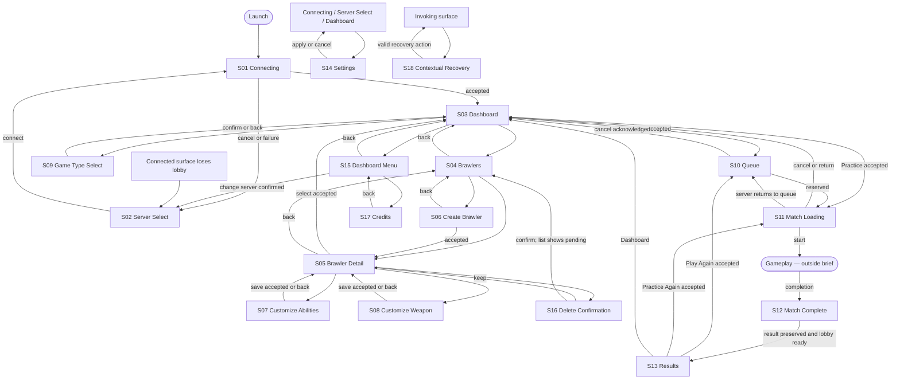

# Screen map and functional briefs

These requirements preserve existing product behavior. Layout descriptions and decorative motion are proposals. Sample names and numbers in generated art are fixture content, never catalog or gameplay changes.

## Navigation

Settings preserves its exact origin; the utility node is notation, not another screen. Match Settings may reuse the component language later, but the in-match menu is outside this brief. Errors can instead require Server Select when the connection has been lost. S16 also supplies the compact confirmation family used by change-server and cancel-loading actions; each keeps its own wording and behavior.

## Shared layout rules

Design the main reference at 1920×1080. Also validate 1591×720, the documented native content size, and a proposed compact study at 1024×768. These are design review canvases, not new supported-resolution guarantees. Keep text/control scale legible; do not solve compact layouts by shrinking the entire frame. Use a 48px reference safe margin, 8px spacing rhythm, 16–24px between related controls, and larger separation between groups. Values are proposal tokens at the reference size.

Back/origin is top left, title adjacent, utilities top right, action rail lower right, input hints along the lower edge. Content scrolls inside its region while navigation/actions remain reachable. Main screens fill the viewport with an opaque background. Only short contextual decisions use overlays.

Selection is persistent and marked with a check plus label; focus is transient and marked by a separate high-contrast outline. Disabled controls carry a reason. Controller and mouse operate the same choices. Avoid hover-only information, drag-only equipment editing, all-color status or tiny unlabeled icon actions.

## S01 — Connecting

- **Purpose:** communicate launch/manual connection progress and retain escape routes.
- **Content/actions:** PewPew Blitz identity, target address, factual connection phase; Cancel, Settings, Quit. No Press Start or extra Title destination.
- **Composition:** large off-center brand graphic and toy-arena silhouette; stable lower status area and subdued utility buttons. Character art is decorative until a selection is known.
- **States:** preparing/contacting/compatibility/catalog progress as actually reported; cancellation; bounded failure routes to S02. No invented percentage or false ready state.
- **Source:** `src/client/flow/screens/connecting.rs`, `connection.rs`.

## S02 — Server Select

- **Purpose:** recover or connect manually to a known server.
- **Content/actions:** address, display name, Connect, favorites with Join/Remove, recents with Join, Settings, Quit; inline validation/failure text.
- **Composition:** connection form at left, saved server rows at right; compact layout stacks form above lists. It should feel like the game's connection desk, with readable editable fields.
- **States:** empty saved list, text entry, invalid address, failed connection, long names and scroll. Recents are history, not discovered live servers. Do not invent ping, region, account login or online badges for unqueried entries.
- **Source:** `src/client/flow/screens/server_select.rs`, `flow/persistence.rs`.

## S03 — Player Dashboard

- **Purpose:** show the player's chosen build and make Play or Practice obvious.
- **Content/actions:** player/server identity and connected status; selected brawler name, readable build summary and View Brawlers; selected advertised game/rules/map pool/population, Change Game; Play, Practice, Settings, Menu.
- **Composition:** real brawler occupies about 45% of the central area on a graphic stage. Build identity sits beside it. Right-hand game card and large Play button form the action focus; Practice is strong but secondary.
- **States:** first-time Create Brawler, selection available, population updating, unavailable previous game, joining/starting pending, unavailable admission. Empty state replaces the hero claim with an invitation and makes the valid create action clear.
- **Source:** `src/client/flow/screens/dashboard.rs`.

## S04 — Brawlers List

- **Purpose:** browse the player's saved builds, inspect one or create another.
- **Content/actions:** saved count/capacity, each name and readable fighter/weapon/ultimate/passive summary, one Selected for Play marker, Create Brawler, Back to Dashboard.
- **Composition:** generous scrollable build cards or rows; one clear repeated structure, not a portrait-only hero roster. Selection and focus remain distinct.
- **States:** empty with Create CTA, populated, capacity reached, pending deletion, list refresh/failure. Opening a card inspects it; it does not silently select for play.
- **Source:** `src/client/flow/screens/brawlers.rs` (`spawn_brawlers` family).

## S05 — Brawler Detail

- **Purpose:** understand and select a saved build or enter customization.
- **Content/actions:** name, permanent fighter profile/weapon base, resolved fighter and weapon statistics, 3D preview, ultimate/two passives, parts equipped out of four; Select for Play, Customize Abilities, Customize Weapon, Delete Brawler, Back.
- **Composition:** brawler on left, structured loadout and stat groups on right; selection CTA near the build summary. Delete is visually separated from constructive actions.
- **States:** selected, selecting pending, missing stats, operation rejected, long name. Stats use real units; no invented power rating or progression meter.
- **Source:** `src/client/flow/screens/brawlers.rs`.

## S06 — Create Brawler

- **Purpose:** choose permanent foundations and an initial ultimate.
- **Content/actions:** server-advertised fighter profile, weapon base, starting ultimate and their explanations; Create Brawler, Back. Explain that fighter profile/weapon base are permanent and abilities can change later.
- **Composition:** three numbered choice groups with descriptions and a subordinate preview area. Numbering expresses grouping, not a newly required multi-step wizard.
- **States:** current choices, creating pending, server rejection, capacity unavailable. Do not invent skin selection, initial part purchases or a required name field; name editing belongs to S07 in the current flow.
- **Source:** `src/client/flow/screens/brawlers.rs`.

## S07 — Customize Abilities

- **Purpose:** edit a local draft of name, ultimate and two distinct passives.
- **Content/actions:** read-only permanent profile/base, editable name, ultimate, Passive 1, Passive 2, Save Changes, Back; advertised choice descriptions and rejection text.
- **Composition:** identity column and spacious ability choice cards. Show the current choice and how to cycle available options; expanded choice presentation is an optional layout proposal, not new unlock behavior.
- **States:** focused name/caret, ability focused, duplicate/invalid choice feedback, saving, rejection; save accepted returns to detail and Back discards the draft.
- **Source:** `src/client/flow/screens/brawlers.rs`, `flow/reducer/profile.rs`.

## S08 — Customize Weapon

- **Purpose:** assign owned parts to four generic slots and inspect the resolved weapon.
- **Content/actions:** permanent weapon identity, four numbered equipped slots, owned inventory with part descriptions, current slot, Unequip Selected Slot, live resolved numerical preview, Save Equipment, Back; Invalid Part Combination feedback.
- **Composition:** slot rail at left, owned parts center, readable preview right. On compact layout stack preview below the editor and allow scrolling. Equipment manipulation must work with focus/confirm, not just dragging.
- **States:** empty/filled/focused slots, selected inventory candidate, valid preview, invalid combination, empty inventory, pending save/rejection. No rarity, cost, unlock tree or dedicated anatomical slot names. Optional baseline-versus-draft deltas must be derived from real values at implementation; they are not an existing mandatory feature.
- **Source:** `src/client/flow/screens/brawlers.rs`, `flow/reducer/equipment.rs`.

## S09 — Game Type Select

- **Purpose:** draft a choice among this server's advertised game types.
- **Content/actions:** advertised name, mode/team topology, rules, map pool, population; current draft marker, Confirm, Back; previous-game-unavailable message when relevant.
- **Composition:** illustrated editorial cards with comparable factual summaries; active card has the same selection grammar as the brawler list. Pool art must not imply a reserved map.
- **States:** focus versus draft versus currently committed selection, population updating, advertisement removed. Confirm selects only; it never queues. Do not add free map/team selectors or modes the server did not advertise.
- **Source:** `src/client/flow/screens/game_select.rs`, `dashboard.rs` summary helpers.

## S10 — Queue

- **Purpose:** communicate an accepted multiplayer request while waiting for reservation.
- **Content/actions:** frozen accepted game/build summary, actual waiting count and match size when available, Updating Queue fallback, Cancel Queue.
- **Composition:** selected brawler remains present; a rhythmic abstract assembly motif communicates activity alongside a quiet factual status panel.
- **States:** waiting, population updating, Cancelling with action disabled, reservation transition. No invented ETA, progress percentage, opponent identities or filled roster seats inferred from pool count. Exit after cancellation acknowledgement.
- **Source:** `src/client/flow/screens/queue.rs`.

## S11 — Match Loading

- **Purpose:** show reserved-match handoff/readiness without obscuring cancellation.
- **Content/actions:** current reported phase, authoritative topology/map identity when known, accepted build; Cancel Match Start with contextual confirmation when required.
- **Composition:** atmospheric map/arena illustration around a stable phase label and non-percentage activity indicator. Use neutral arena art until the map is actually known.
- **States:** Reserving Roster, Starting Server, Connecting, Synchronizing Map, Waiting for Players, Cancelling, Returning to Queue. Illustrate representative variants, not an invented linear completion promise. Countdown is gameplay-owned and excluded.
- **Source:** `src/client/flow/screens/match_loading.rs`, `overlays.rs`.

## S12 — Match Complete bridge

- **Purpose:** preserve the authoritative result during lobby return.
- **Content/actions:** outcome plus Returning to Lobby. No buttons or new choices.
- **Composition:** a short outcome graphic using the Results language; steady status underneath, no long forced celebration.
- **States:** authoritative team win/draw/forfeit, or advertised cooperative clear/overrun. Delay remains legible; art must not imply lobby is already ready.
- **Source:** `src/client/flow/screens/results.rs`.

## S13 — Results

- **Purpose:** understand the outcome and choose exact replay or Dashboard.
- **Content/actions:** authoritative outcome, local team context, available recorded game summary; Play Again or Practice Again as appropriate, Dashboard. Replay Unavailable with explanation when the prior game is absent.
- **Composition:** outcome headline, restrained brawler celebration/defeat pose, compact factual result block, clear replay action. Use only recorded facts; no invented kill tables, XP, medals, currency or rank change.
- **States:** victory/defeat/draw/forfeit; cooperative clear/overrun when applicable; replay unavailable. Match tone without humiliating defeat effects.
- **Source:** `src/client/flow/screens/results.rs`.

## S14 — Settings

- **Purpose:** edit local settings with explicit Apply/Cancel and return to the invoking surface.
- **Content/actions:** implemented move/aim deadzones, aim commit threshold, trigger press/release thresholds, keyboard/gamepad bindings, mouse primary mapping, move/aim Y inversion; UI scale, Reduced Motion, Reduced Effects, master volume, mute unfocused, fullscreen, VSync; Reset, Apply, Cancel.
- **Composition:** proposed full-screen grouped rows: Controls, Display & Accessibility, Audio. These headings group existing fields; they do not add settings. Keep selected field/value and bottom actions visible.
- **States:** draft modified, binding capture with Escape/gamepad East cancel instruction, binding conflict, reset, validation/persistence error, controller unavailable. Include a long binding list and scroll affordance. No new guided calibration flow (BRL-0050 owns that).
- **Source:** `src/client/shell.rs`, `settings/ui.rs`, `settings/persistence.rs`.

## S15 — Dashboard Menu

- **Purpose:** access connected utilities while keeping Dashboard context visible.
- **Content/actions:** Credits, Favorite Server/Remove Favorite, Change Server, Quit, Back.
- **Composition:** compact opaque side panel with dimmed Dashboard underneath, large labeled rows; no competing Home hub.
- **States:** favorite on/off, focus on each row, change-server confirmation. Settings remains accessible from Dashboard and is not an invented menu item here.
- **Source:** `src/client/flow/screens/dashboard.rs`.

## S16 — Confirmation family

- **Purpose:** resolve a short contextual decision without losing the invoking surface.
- **Required example:** Delete Brawler? named target, This Cannot Be Undone, Keep Brawler, Delete. Keep Brawler is the initial safe focus.
- **Variants:** Change Server? with disconnect explanation and Stay Connected/Change Server; cancel loading with Keep Loading/Cancel Match Start. No generic OK/Cancel wording when a specific action is available.
- **Composition/states:** centered compact panel over the visible actual origin; destructive action uses error color plus label/icon. Pending mutation belongs to the existing flow, not a fictitious success toast.
- **Source:** `src/client/flow/screens/brawlers.rs`, `overlays.rs`.

## S17 — Credits

- **Purpose:** provide readable attribution and return to origin.
- **Content/actions:** game identity/version, actual engine/font/art/audio attribution and license text references, Back. Exact required attribution comes from the shipped manifest/license inventory and current credits, not model invention.
- **Composition:** calm readable scrollable panel, small brand motif; no auto-scrolling text that requires waiting.
- **States:** scroll and focus. A proposed larger reading surface may replace the current compact overlay while preserving origin.
- **Source:** `src/client/shell.rs`, `assets/manifest.ron`.

## S18 — Contextual Recovery

- **Purpose:** explain a factual problem and expose only valid recovery actions.
- **Content/actions:** specific problem title, concise consequence, action labels taken from the actual failing flow. Examples: inline rejected save in editor; invalid address in S02; local settings save error; lost lobby leading to S02.
- **Composition:** shared error icon/message treatment; use inline errors for fields and a compact overlay for blocking contextual problems. Preserve valid drafts/context where existing behavior does.
- **States:** validation, compatibility/connection, save/persistence, replay unavailable, stale data. Do not give every error an unsupported Retry. Do not show a stale connected Dashboard as a functioning home after lobby loss.
- **Source:** `src/client/flow/screens/overlays.rs`, `src/client/shell.rs`, relevant reducer/connection modules.
