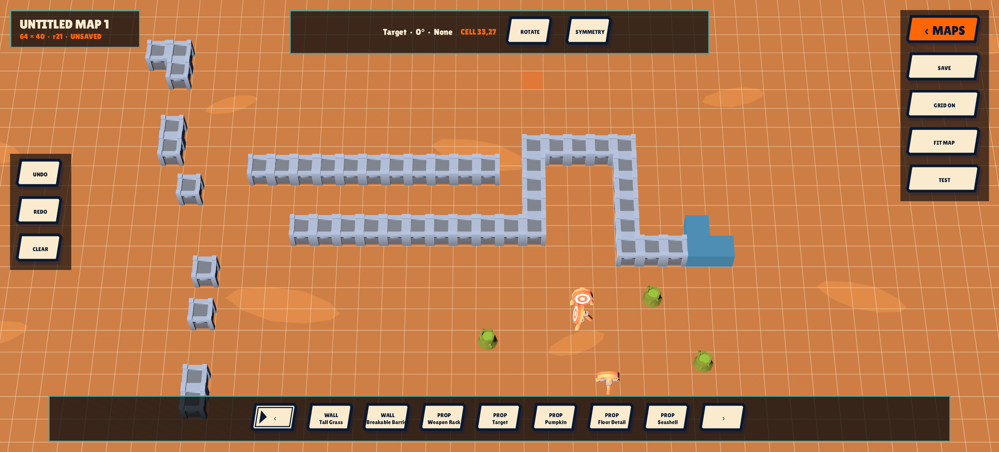
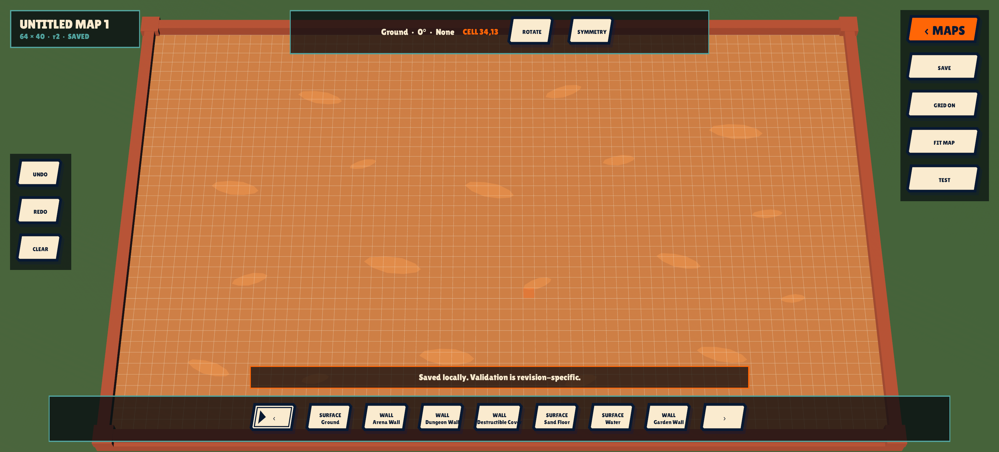
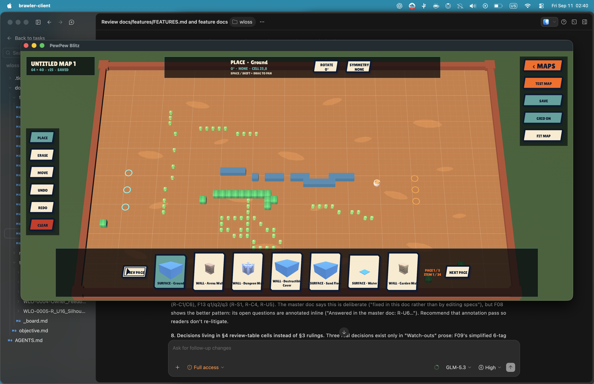
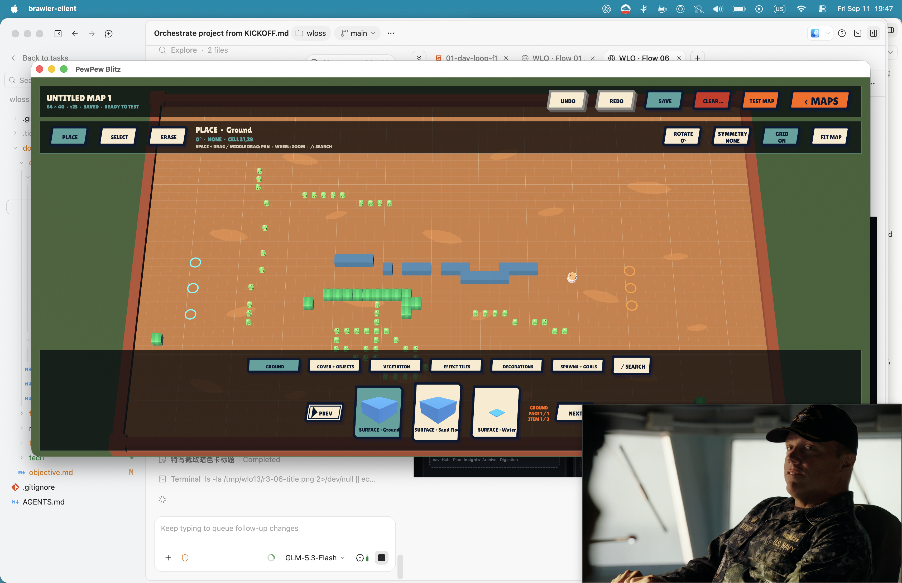
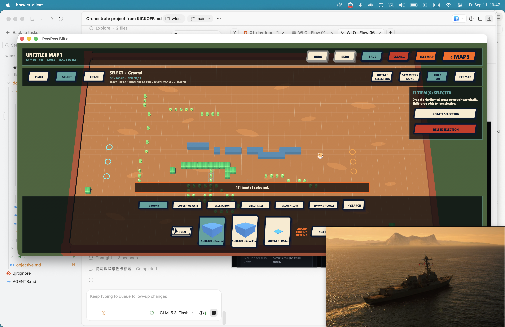
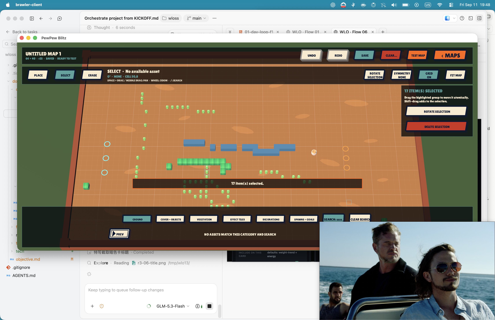
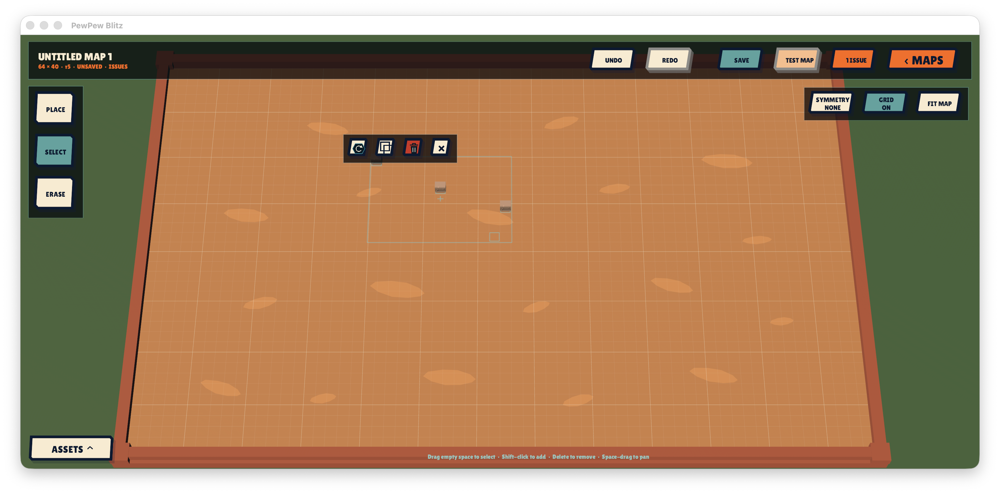
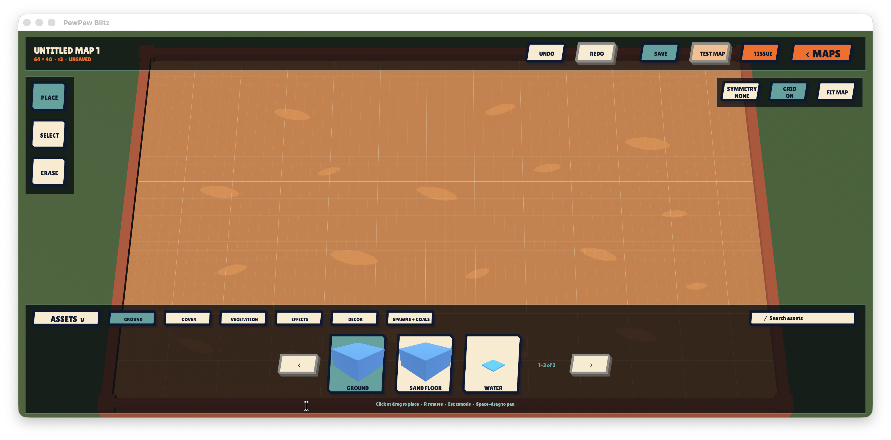

# Map Maker specification — draft for review

Prepared 2026-09-10 from all 12 screenshots in `inspiration/map_builder/`, the existing BRL-0037 scope, related Ticket records, durable map/player-flow documents, and current source. This is specification work only. BRL-0037 remains backlog; implementation and native visual design have not started.

The existing create/edit/validate/save/reopen/duplicate/delete/Practice scope is retained. Detailed UX below is proposed behavior for review, not a claim of an approved screen design. The symmetry addition is explicitly called out for a product decision.

## Outcome

A player opens Map Maker from the Dashboard, creates an arena from approved assets, saves an unfinished draft, fixes highlighted problems, and tests an accepted revision in ordinary server-authoritative Practice. They can return to the same draft, revise it, and repeat without editing files or restarting the application.

Player-facing name: **Map Maker**. It authors layout and supported typed parameters. The selected game mode continues to own scoring, victory, respawn, objectives, and bots.

## Reference-image analysis

All filenames below are relative to `inspiration/map_builder/` and use the prefix `Screenshot_20260909-`.

| Image | Directly visible evidence | Brawler application |
| --- | --- | --- |
| `221358.png` | Create New card, draft count 0/5, named Heist maps, overflow menus, Rejected and Submitted/approval states. | A personal map library with recognizable map previews and contextual actions. The five-draft limit and publishing/approval workflow are reference-specific; neither is an adopted requirement. |
| `221429.png` | Create modal with map-name field, Heist selection, environment image, two rows of arrows, Create action. | Ask for name, supported mode/team size, dimensions, and theme/default ground before editing. The second arrow row appears to concern environment choice; the still image does not prove its behavior. Use Brawler's full-screen flow preference. |
| `221439.png` | Large empty arena canvas; map/mode identity; Undo, Redo, Clear All; Quit, Save, Grid, Modifiers; bottom asset strip; Single placement label. | Keep the arena dominant, separate editing tools from document actions, show active tool, and retain persistent save and history access. |
| `221445.png` | Same canvas with a cell grid overlaid. | Grid visibility is independent of grid snapping. The floating thumbnail/share/edit controls are screenshot-system overlays, not map-maker features. |
| `221449.png` | Modifiers panel with Energy Drink, Tilt, Super Charge, Fast Brawlers and on/off controls. | This is a separate match-rules feature. Do not bring it into layout authoring or expose Balance Lab tuning as map settings. |
| `221503.png` | Additional palette section: blue/red circular markers, safe icon, arrow pad, four colored pads, cloud/health/effect icons; counters such as 3/3, 2/2, 0/2. | Show labelled team-spawn and objective requirements alongside placement budgets. The screenshots alone do not establish whether these fractions mean placed or remaining; use explicit wording in Brawler. |
| `221509.png` | Further palette positions including opposing-arrow and spike icons. | Categories and readable asset names should make a growing catalog navigable. Do not infer or implement mechanics solely from icon appearance. |
| `221920.png` | An edited grid containing cover, vegetation, water, objects, markers, pads and hazards; enabled Undo and Save. | Placement previews must agree with actual footprint and gameplay. Repeated wall pieces read as continuous cover, while markers remain visually distinct. |
| `221940.png` | Placement mode reads Mirror horizontal with a two-column icon. | Candidate left/right symmetry tool with visible axis and ghost placements. |
| `221943.png` | Placement mode reads Mirror vertical with a two-row icon. | Candidate top/bottom symmetry tool. |
| `221944.png` | Placement mode reads Mirror diagonal with opposite-corner icon. | Use an unambiguous “Rotate 180°” option if adopting opposite-corner duplication. The reference label alone does not prove its coordinate transform. |
| `221946.png` | Placement mode reads Mirror all with four-square icon. | Candidate four-way symmetry, with one transaction for all copies. |

The screenshots demonstrate screen structure and tool availability, not drag gestures, autosave, collision rules, save validation, playtest entry, controller support, or error recovery. Those behaviors below come from Brawler's needs and are proposed explicitly. Borrow interaction patterns, not the reference game's branding, icons, artwork, or exact screen chrome.

## Existing-ticket review

Reviewed `ticket list --open --limit 0`, the map search, and the exact phrase search for map maker/map builder/map editor. BRL-0037 is the sole directly matching open map-maker ticket; do not create a second implementation owner.

| Ticket | Status on review | Relationship |
| --- | --- | --- |
| BRL-0037 — Add a bounded player-facing map builder | backlog | Owns this complete player-facing slice and specification. |
| BRL-0117 — Choose a map before starting Practice | done | Reuse approved full-screen, recipe-overview selection, separate focus/choice states, server-approved availability, and selected-map Practice lifecycle. Its built-in selection does not yet admit a custom recipe. |
| BRL-0036 — Add authored gameplay effect tiles | done | Speed, Slow, and Damage tiles are existing authorable features. Reuse their catalog, authority, spawn-clearance and presentation rules. |
| BRL-0034 — Add a second purpose-built Wipeout map | backlog | Separate level-design work. The editor must not depend on delivery of another built-in map. |
| BRL-0108 — Preview VFX on production game maps in VfxLab | todo | Adjacent read-only map-presentation work; it does not own editing, persistence, or custom-map admission. Reuse production presentation where appropriate, not the lab as the product editor. |
| BRL-0033 — Expand Practice bots across current weapon and ability matchups | backlog | Bot-quality follow-up. Existing server bots suffice for editor testing; validation does not certify tactical bot quality on every layout. |
| BRL-0035 — Add the Gem Grab team objective mode | backlog | Separate mode delivery; no Gem Grab anchors in this slice. |
| BRL-0039 — Add the solo Showdown elimination mode | backlog | Separate mode delivery; no shrinking arena, elimination-rule or solo-spawn authoring in this slice. |
| BRL-0045 — Add a pickup-driven loadout sandbox | backlog | Development-only gameplay work, not a generic pickup palette requirement. |
| BRL-0110 — Add the Zombie cooperative survival mode | doing | Current source contains Zombie ingress and mode support, but BRL-0037's first slice remains Wipeout/Hot Zone/Heist. Enabling Zombie authoring needs an explicit scope decision and its own anchor/roster verification. |
| BRL-0121 — Close failed match-loading workers through the supervisor lifecycle | backlog | Relevant failure-cleanup risk for custom Practice launch. Reuse the supervisor lifecycle and coordinate any shared fix through its owner. |

No publishing, moderation, shared editing, or browser-editor work is introduced by this specification. Existing exclusions remain exclusions; the reference images do not create new backlog commitments.

## First playable slice

- Native Dashboard → My Maps → Create Map → Editor.
- Wipeout, Hot Zone, and Heist, with a server-supported Practice roster; default to the current compatible Dashboard game selection.
- Select name, dimensions, theme and default surface from supported choices. Default dimensions to a compatible approved map's dimensions; display cell dimensions explicitly.
- Paint/place, inspect/select, erase, move an existing placement, and apply legal quarter-turn rotations.
- Surface, feature, decoration and marker composition; team spawn markers; the selected mode's typed objective anchors.
- Grid toggle, pan/zoom, fit entire map, asset categories, understandable asset properties, undo/redo, explicit save, validation, and Test in Practice.
- Local draft library with reopen, rename, duplicate and delete.
- Authoritative validation before allocation and an immutable accepted revision through the routed match worker.
- Proposed extension from the references: left/right, top/bottom, 180° and four-way placement symmetry. Decision recorded as a Ticket question before this becomes implementation scope.

## Screen and interaction contract

### My Maps

Use the existing player-shell visual language and full-screen navigation. Display Create Map prominently, then saved maps with an actual recipe-derived overview, name, mode, dimensions and useful draft state. Do not substitute generic environment artwork for the layout preview.

Each map opens the editor. Context actions provide rename, duplicate and delete; they remain reachable with controller focus. Separate focus from selection consistently with BRL-0117. Show a clear empty-library state. Do not imitate Submitted/Rejected/approval badges.

Distinguish document state from playability: “Saved locally” describes persistence; “Needs validation” or “Ready to test” describes the exact revision and connected server context. Show a local-storage error beside the affected map/action.

### Create Map and map settings

Use a full-screen creation form with name, mode/team-size selection, width × height in cells, theme, default ground, and Create. Only supported catalog choices appear. Creating a blank map installs default ground but may leave missing spawns/anchors; it is a valid draft, not yet a playable map.

Name changes affect library metadata. A draft has one mode; changing mode after creation is outside this first slice. Re-evaluating compatible Practice team size rechecks spawn capacity without silently changing markers. Theme changes must not silently substitute gameplay assets.

Dimensions may be edited within admitted bounds. Expansion preserves existing cell coordinates. Shrinking previews affected placements and anchors, and refuses the resize while any would be clipped; the player moves/removes them first. A resize is undoable. A default-surface change must preview resulting compatibility errors and leave explicit surface placements intact.

### Editor composition

Keep a large central arena, a compact map/title bar, persistent Save and Test actions, editing tools, and a bottom asset palette with categories. A small inspector presents selected-asset information and only its legal parameters. Validation details can occupy a dismissible side panel without changing tools or losing the camera position.

Use the production 3D map assets and coordinate conversion for preview, plus editor-only grid, outlines, ghost footprints and spawn/objective handles. Provide a predictable fixed orientation; pan, zoom and Fit Map keep every cell accessible. Grid lines must remain readable without overwhelming terrain, and toggling them never changes snapping.

Categories: Ground; Cover and Objects; Vegetation; Effect Tiles; Decorations; Spawns and Objectives. These are navigation groupings over catalog facts, not new gameplay classes. Label assets on focus/hover and show footprint, movement/projectile blocking, destructibility or durability, concealment/effect behavior, and surface restrictions where applicable.

The palette uses existing approved assets, including walls/cover, water, tall grass, oil barrels, treasure chests, and Speed/Slow/Damage tiles when supported. Runtime debris/replacement states are not automatically initial-placement choices merely because they exist in the catalog. Establish an explicit bounded authorable set. No Heal tile, teleporter, jump pad or arbitrary dropped pickup is implied by the reference palette.

### Editing semantics

- Hover/cursor previews the full rotated footprint at the stored cell origin, including any copies. Green/invalid styling must also have an icon or message; do not rely on color alone.
- A click/confirm places once. Pointer drag paints a continuous grid stroke with repeated cells deduplicated; a completed stroke is one undo step. Capture the chosen asset/rotation at stroke start and cap its work using the same document budgets.
- Only the active slot is replaced. Replacing a multi-cell placement removes that entire placement; preview the full affected area. Other slots survive. Structural slot/footprint/surface conflicts reject the edit with a reason rather than deleting unrelated content.
- Erase removes a whole explicit placement in the chosen slot. Erasing an explicit surface override restores the map's default surface. Default ground itself cannot be erased into an undefined cell.
- Inspect makes overlapping slots selectable. Move/rotate validate the entire resulting footprint before committing and preserve placement identity. Failed edits leave the draft unchanged.
- Temporary semantic problems such as missing spawns or blocked routes may exist and be saved. Direct manipulations still enforce representational safety, occupied-slot rules and catalog parameter bounds.
- Undo/redo covers placement strokes, erase, move, rotate, map settings and Clear Map. One gesture is one transaction. New edits after undo clear redo; no-op/rejected actions add no history. History has explicit entry and byte bounds; save does not clear it, reopen may.
- Clear Map requires a concise destructive-action confirmation, retains map settings/default ground, removes placements and anchors, and is undoable.
- Save remains available for safe incomplete drafts. Leaving with unsaved edits offers Save, Discard, or Keep Editing; a failed Save leaves the draft open and dirty.
- Disable history actions when unavailable and explain disabled Test through the validation status. Tool input must not leak into shell buttons or gameplay.

Keyboard/mouse controls: click/select/place, drag paint, explicit erase tool, R for allowed rotation, platform undo/redo and save shortcuts, Space+drag pan, wheel/trackpad zoom, Fit Map control, Escape to cancel the current operation before leaving. Text entry owns its keys.

Controller controls: discrete grid cursor and palette/toolbar focus, visible place/select and cancel prompts, accessible rotate/erase/history/save/test actions, and pan/zoom without pointer emulation. Final bindings follow existing settings conventions and must be documented and playtested. Controller coverage remains part of the existing acceptance criteria.

### Proposed symmetry semantics — pending scope decision

Use explicit labels and axis previews: None, Left/Right, Top/Bottom, Rotate 180°, Four-way. These affect new painting/erasing transactions, not the whole existing map. Move/inspect acts on the selected placement only.

For a one-cell placement at (x,y) on W×H cells, opposite positions are (W−1−x,y), (x,H−1−y), and (W−1−x,H−1−y). For a footprint w×h, reflect its occupied extent using W−x−w and H−y−h. Deduplicate placements on symmetry axes. Apply allowed orientation transforms; if an asymmetric asset cannot represent a reflection using its catalog rotations, disable that symmetry for the asset with an explanation.

Preview and validate all copies before committing; failure at any copy rejects the whole transaction. An erase affects whole placements under the corresponding footprints and is one undo step.

Keep spawn markers and mode anchors in their explicit placement tools in the first symmetry implementation. Automatically mirroring team-owned items introduces team/ordinal/anchor ambiguity; Heist's paired-objective workflow below handles that bounded case explicitly. No diagonal-axis reflection or symmetry-enforcement rule is implied.

## Spawns, objectives and validation

Show requirements as explicit counts, e.g. “Team A spawns: 2 placed / 3 required,” plus count/budget information for restricted asset families. Use team names/icons as well as colors. Counts are derived from the chosen compatible roster and current recipe, never copied from the reference screenshots.

Spawn tools expose team, ordinal and legal facing through typed parameters, with uniqueness and capacity feedback. Preview fighter clearance around each spawn. The canonical fighter radius is 14 world units in a 32-unit cell; use the shared geometry rather than editor-only estimates.

| Mode | Authoring requirement |
| --- | --- |
| Wipeout | Compatible team spawns; no objective anchors. |
| Hot Zone | Compatible team spawns and exactly one capture circle; center and radius use the existing half-cell representation and resolver bounds. Draw the complete capture area and use half-cell handles for this tool. |
| Heist | Compatible team spawns and exactly two objectives, one per team, using the existing 3×2 cell anchor contract, supported orientation/visual and clearance rules. A paired placement tool can offer the counterpart while keeping team identity explicit; preview both and submit together. Reuse current access checks rather than imposing a new whole-map symmetry constraint. |

Validation has two levels: immediate local editing feedback and authoritative validation of the candidate on the connected server. Local preflight reuses headless rules where available and never grants admission.

Errors identify a cell, placement, anchor, field or document limit and provide an actionable reason. Selecting an error focuses the relevant location/control. At minimum cover unknown IDs/schema, invalid dimensions/rotations/parameters, duplicate identities, overlaps, illegal surfaces, missing/unsafe spawns, roster mismatch, missing/extra/wrong-mode anchors, inaccessible routes/objectives, and source/expanded/runtime budgets.

Reuse actual effect-tile constraints, including spawn overlap prohibition and Damage-tile adjacent-spawn clearance. Fairness, fun and bot performance require playtesting; successful validation is not a balance certificate.

Edits, roster changes, server changes, reconnects or content/policy changes invalidate prior “Ready to test” state. Results for an older request/revision must not validate the current draft.

## Local persistence and recovery

Keep the original ticket's local-save scope. Store a bounded document envelope containing stable local identity, name, schema/version, recipe revision, intended Practice selection and the canonical MapRecipe. Editor camera/tool/history are not authoritative recipe facts. Generated thumbnails are disposable presentation caches.

Use app-owned local storage with atomic replacement; never write player drafts into embedded content/maps, assets catalogs or profile gameplay data. Preserve the last complete save on write failure. Duplicate creates a new identity; rename does not. Deleting requires confirmation and must not affect an already-running accepted match snapshot.

Safe incomplete drafts remain reopenable. Malformed, oversized or unknown-schema files fail closed without being overwritten. Stale catalog references remain visible as repairable or unavailable content; do not silently remove placements or migrate unknown semantics. Saving cannot manufacture a server-accepted state. Last saved data survives restart; crash recovery of unsaved edits/autosave is not promised by this first slice.

Set and document finite library, name, draft-byte and undo-history limits before implementation verification. Surface the applicable limit and recovery action. The reference's five-map cap is not an adopted product decision.

## Server validation and Practice handoff

1. Test in Practice completes any edit gesture and saves the candidate revision locally. If saving fails, preserve the editor and do not allocate a match.
2. Submit the bounded candidate and selected advertised game type through an explicit authenticated validation/admission operation. One operation may be pending per editor session.
3. Server checks authoring availability, catalog/protocol identity, mode, exact roster, operator map envelope, counts and byte budgets. Parse and preflight bounded counts before expanding filled rectangles or allocating large buffers.
4. Resolve using the shared recipe path. Bind the accepted canonical recipe/fingerprint, revision, catalog context and topology to this session/reservation. Never treat a client validation flag or arbitrary preset ID as authorization.
5. Carry that immutable accepted map through the existing supervisor/IPC/match-worker path. Worker verifies the admitted content and installs through ordinary map runtime. Replicate the accepted map using normal client readiness/recovery and presentation.
6. Cancellation, capacity rejection, disconnect, timeout and worker failure preserve the saved draft and return an actionable state. Release the reservation/worker through existing lifecycle ownership; stale success responses cannot launch a canceled operation.
7. Practice uses the selected saved brawler and current server-hosted bot policy. Scoring, health, terrain destruction, objectives and results remain server-owned.
8. On completion or deliberate playtest exit, retain ordinary results/leave handling and offer Return to Editor. Restore the same local document and view context after the lobby transition. If teardown/reconnect fails, retain a safe path back to My Maps with the saved draft.
9. Practice Again reuses that accepted map revision when compatible; Return to Editor and edit requires fresh acceptance. Destruction, pickups and other runtime changes never write back into the recipe.

Preserve built-in Practice defaults and multiplayer map pools. Private authored Practice does not publish the draft or insert it into advertised pools.

## Technical grounding and required changes

Verified against current local source:

- `src/map/catalog.rs`: MapRecipe stores identity/revision/schema, mode, theme, dimensions, default surface, sparse placements, filled rectangles and typed mode anchors. Names/library metadata belong outside this gameplay shape.
- `src/map/resolution.rs`: existing path validates, expands, canonicalizes, fingerprints and derives runtime facts. Current entry takes a preset ID and creates a snapshot with `source_preset_id: Some(...)`; authored maps need an intentional provenance path, not a fabricated built-in preset.
- `src/map/model.rs`: snapshot provenance already has optional source preset identity. Reuse it deliberately while preserving stable recipe/placement identity.
- `src/server/admission.rs` and lobby Practice selection currently validate built-in preset identity/revision. Custom recipe transport and acceptance are real new work.
- `src/client/flow/screens/practice_maps.rs` and BRL-0117 provide the approved library-overview and map-selection foundation, not an editor.
- `docs/04-maps-and-game-modes.md`, `docs/16-grid-map-asset-system.md`, `docs/08-network-architecture.md`, `docs/13-player-ux.md`, and `docs/14-multiplayer-server-architecture.md` govern authority, roles, compatibility and user flow.

Editor state, persistence, validation transport and map presentation need clear owners; begin with focused native modules and existing Bevy UI/presentation, not a new editor framework. Server-known catalog facts must drive legal choices. Client labels/previews cannot change gameplay.

New wire/IPC shapes require the global compatibility handshake update and fingerprint review. Keep executable registries sealed. Do not add per-message schema decoders, a second resolver, a client-side match simulation, arbitrary component serialization, asset upload, or hot modification of compiled gameplay catalogs.

Current structural limits include 1..=512 cells/axis, operator policy currently 20..=512 per axis, a 32 MiB resolved-snapshot ceiling, and separate effect-tile/damageable/runtime budgets. These are safety limits, not a claim that dense 512×512 editing/rendering is usable. Before implementation, choose and document a measured authoring/admission budget no greater than those limits, enforce it before expansion, and advertise it to the editor. Do not accept a large compressed recipe solely because its source payload is small.

## Acceptance and verification

1. A player completes create → edit → save → close/reopen → validate → routed Practice → results/return-to-editor in each of Wipeout, Hot Zone and Heist using approved assets.
2. The library shows actual map overviews and supports rename, duplicate and delete with stable identity and no draft loss.
3. Surface/feature/decoration/marker rules, multi-cell rotation/removal, drag history, resizing, Clear Map and dirty-state handling behave as specified with keyboard/mouse and controller.
4. If symmetry is approved, verify the transforms, odd/even map centers, multi-cell extents, axis deduplication, unsupported reflection and atomic failure/undo with focused representative cases.
5. Save/reopen accepts safe incomplete maps. Corrupt/stale/unknown-schema/oversized data and save failures preserve recoverable data and expose useful actions.
6. Client and server reject unsupported or stale content, unsafe geometry, missing/invalid spawns/anchors, oversized expansion and incompatible roster. The server never allocates on local validity alone.
7. Accepted recipe identity and geometry remain consistent across admission, worker, client readiness, restart/recovery and Practice Again. Existing built-in launch defaults remain valid.
8. Cancellation, disconnect and failed loading release owned resources and retain the draft. Runtime map mutation never leaks into editing data.
9. Native verification covers a representative tall map, wide map, layered cells and dense supported recipe, plus a smaller window/UI scale, both input methods and primitive fallback. Report edit responsiveness and admitted density/byte limits; do not claim structural maxima as tested performance.
10. Update durable map/player-flow/network documentation for implemented behavior, record all feedback dispositions and a learn-from-errors review, and mark done only after required evidence and user playtest acceptance.

Implementation verification should use focused owning-module rule/ECS tests, role-specific checks, meaningful separate-App admission/recovery scenarios and existing routed Practice harnesses extended to submit a custom recipe. Existing built-in-only smoke is insufficient proof of custom admission.

Canonical commands are `just check`, `just lint`, `just test`, and representative `just practice-e2e wipeout-3v3`, `just practice-e2e hot-zone-3v3`, `just practice-e2e heist-3v3`; extend the existing harness rather than inventing an alternate process topology. Track unrelated failures through their existing owners, including BRL-0134 for the known strict test-target Clippy backlog.

Native user playtest handoff: `just server` + `just client`; Dashboard → Map Maker; create each supported mode; place cover, spawns and objective(s); repair one highlighted error; save/reopen; test; return and adjust. Ask specifically about cell targeting, palette discovery, camera control, undo predictability, error clarity, and time to repeat a playtest.

## Specification-work evidence and review disposition

- All 12 supplied images inspected individually; observed controls distinguished from inferred behavior and OS screenshot overlays.
- Existing BRL-0037 reused; open/related/completed tickets reviewed. Existing local persistence, three-mode scope and controller requirement preserved.
- Actual recipe/anchor, resolver, Practice picker and built-in admission code checked. No web research or gameplay code changes were needed for this specification.
- Reusable lessons: static screenshots do not establish gesture or save semantics; an optional provenance field does not prove custom-map admission already works; sparse source size does not bound expanded work.
- Draft remains subject to product/screen review. Symmetry is the explicit proposed scope addition. Numeric authoring/library/history budgets need implementation-time evidence and must be recorded here before coding the dependent limits.

## Approved implementation limits and symmetry decision (2026-09-10)

The user approved all four proposed symmetry tools: Left/Right, Top/Bottom, Rotate 180 degrees, and Four-way. They remain atomic new-edit transforms; spawns and objectives remain explicit tools.

The first implementation uses these measured, finite authoring limits, all below existing engine ceilings: 64 local drafts; 48 Unicode graphemes and 96 UTF-8 bytes per normalized name; 20..=128 cells per axis and at most 16,384 cells total; 4,096 expanded placements including filled rectangles; 256 KiB per canonical source recipe; 512 KiB per saved document envelope; 128 undo entries and 4 MiB serialized undo history. Admission rejects a candidate before expansion when its source counts, bytes, dimensions, or estimated expanded placement count exceed these limits. The routed immutable recipe payload is capped at 256 KiB independently of the existing 32 MiB resolved-snapshot ceiling. These are supported authoring/admission bounds, not the engine's 512-cell structural maximum.

## Implementation evidence and learning review (2026-09-10)

Implemented the native Dashboard → Map Maker library/editor slice, bounded local document persistence, approved authoring catalog, all four symmetry transforms, atomic pointer strokes, explicit spawn/objective tools, grid cursor and controller actions, undo/redo/Clear/Save, local resolver feedback, and exact-revision Test in Practice submission. Added authored-recipe provenance without a fabricated preset, advertised authoring limits, protocol 47, match-manifest v5 immutable recipe transport, lobby roster/admission validation, and worker revalidation/installation. Updated the durable map, grid-asset, player-flow, network, and server-ownership documents.

Verification: `just check` passed; `just test` passed (2,021 unit/target tests plus 98 serialized separate-App network tests and 12 performance tests); focused Map Maker persistence/model tests passed; authored lobby allocation, routed manifest round-trip, and worker admission tests passed; `just practice-e2e wipeout-3v3`, `hot-zone-3v3`, and `heist-3v3` each reached Active with one human and cleaned workers. `git diff --check` passed. Production client and server Clippy passed with `-D warnings`; canonical `just lint` remains blocked only by pre-existing strict test-target findings tracked by BRL-0134.

Native launch smoke used a fresh `BRAWLER_CLIENT_DATA_DIR`: supervisor and client started and connected without a Map Maker-owned panic. The desktop inspection bridge could not attach to the raw Bevy executable because it is not registered as a macOS application, so subjective visual/input verification and the required user playtest remain open. Keep BRL-0037 in doing until that feedback is dispositioned.

Learn-from-errors review: adding required resources to globally scheduled Bevy systems broke minimal flow-test apps even when the new screen was inactive; screen-owned optional resources and early returns now preserve composability. Catalog authoring capabilities intentionally change the canonical lobby fingerprint, so both focused and checked-in full-catalog golden vectors must be updated together. Changing map selection from preset-only to preset-or-authored exposed raw struct construction in integration fixtures; the `ServerMapSelection::preset` constructor now keeps built-in callers explicit and complete. Future globally scheduled screen systems should start with inactive-state/minimal-App coverage, and wire capability changes should enumerate every canonical digest fixture before the full suite.

## Rejected native delivery and remediation plan (2026-09-10)

The user rejected the first native delivery after hands-on review. This supersedes the visual/input confidence implied by the earlier implementation-evidence section; its automated protocol, persistence, authoring-model, and routed-Practice evidence remains useful, but the player-facing editor is not accepted and BRL-0037 remains `doing`.

Accepted feedback, all requiring correction in this ticket:

- The editor renders a schematic Bevy UI canvas made of colored rectangles instead of the real engine world and production 3D environment assets.
- Mouse/cell targeting is reversed.
- Clicking editor buttons caused multiple panics.
- The layout and visual hierarchy do not match the supplied `inspiration/map_builder` screen family closely enough.

### Screen-reference findings

All 12 supplied screens were reviewed again at original detail. The target hierarchy is a full-screen rendered arena with compact controls attached to the edges: map/mode identity at top-left, placement/symmetry state at top-center, history/document actions on the left, save/grid/exit actions on the right, and a visual asset tray across the bottom. Grid, placement previews, selected footprints, symmetry copies, and placed objects appear in the actual arena. Creation and destructive/validation decisions use centered modal overlays while the rendered world remains visible and dimmed beneath them. The reference does not support a large permanent text sidebar, a colored-block map, or a dense instructional footer. Brawler will adapt this hierarchy to its existing player-shell visual language rather than copy the reference branding.

### Root architectural correction

Retire `draw_recipe` and the `MapMakerCanvas` UI-node renderer. Do not iterate on its colors or rectangles. Add a state-scoped map-editor presentation concern under the existing client 3D presentation ownership. It consumes a locally resolved draft snapshot and materializes it through extracted production map-presentation helpers: the same ground surfaces, theme lighting/materials, imported environment scenes, fitted multi-cell footprints, rotations, generated water/grass/effect tiles, borders, and documented primitive fallback used by gameplay.

Do not install the draft as an authoritative/network `MapRoot`, fabricate a built-in preset, or relax replicated-map validation. Extract the renderer-neutral static-map materialization seam currently inside `reconcile_3d_map`; gameplay continues to feed it from accepted replicated `ResolvedMapSnapshot`, while the editor feeds it from a separately marked, locally resolved preview snapshot. Editor preview entities use a dedicated marker/lifecycle and are removed on editor exit or snapshot revision change. Authoring still commits only typed recipe operations; rendering never mutates the draft.

Add editor-only world overlays on the XZ plane for the grid, hovered cell, selected footprint, legal/illegal placement ghost, symmetry axes and deduplicated copies, spawn clearance, and objective extent. Keep overlays presentation-only and visually distinct from committed objects. Reconcile only changed preview/world state; do not despawn and rebuild the complete UI tree on every cursor movement.

### Remediation sequence

1. **Stabilize and reproduce before redesign.** Capture `RUST_BACKTRACE=1` traces and exact click sequences for every reported panic using a fresh client-data directory and an existing populated directory. Add focused regression tests before fixing each reproduced failure. Audit all Map Maker systems for inactive-state execution, missing optional resources, stale entities across deferred despawns, duplicate/multiple button interactions in one frame, dialog/world input overlap, and empty/stale palette/document state. State-gate library systems to `MapLibrary` and editor systems to `MapEditor`; initialize required state at the owning plugin boundary; use fallible entity/query handling; consume one deliberate UI action per interaction edge. Remove the whole-tree render-revision loop and ensure a click cannot both activate chrome and edit the world.

2. **Cut over to the real 3D preview.** Extract and reuse the production static environment materializer, theme setup, asset-fit logic, and cell/world geometry. Introduce a dedicated editor preview root and camera without changing server authority or the routed test contract. Validate both imported assets and `BRAWLER_FORCE_PRIMITIVE_WORLD` through the same editor composition. The colored-block renderer is deleted once the 3D preview is functional.

3. **Correct camera and pointer semantics.** Give the editor a top-down/angled arena camera with Fit Map, bounded pan, and bounded zoom. Convert window cursor coordinates with the production camera viewport ray and ground-plane intersection (`cursor_ground_point`), then use a shared inverse of canonical map cell/world geometry. Do not derive cells from UI-relative coordinates. Define and test that increasing screen-right selects increasing map X and that moving toward the visually far/top map edge selects the corresponding canonical map Y. Space-drag pans, wheel/trackpad zooms, pointer capture ends cleanly outside the viewport, and Escape cancels the active gesture before navigation. UI hit-testing has precedence over world editing.

4. **Rebuild the UI to the reviewed hierarchy.** Make the 3D arena the dominant full-window surface. Use compact edge-mounted rails, icon plus tooltip/label affordances, clear disabled states, and a bottom visual asset tray with production thumbnails/icons, category grouping, footprint/count information, and an unmistakable selected item. Put the selected placement/symmetry mode and axis indicator in the top-center strip. Use modal overlays for Create Map, validation details, unsaved-leave choice, Clear, and delete. Retain accessible text and controller focus/prompt equivalents without restoring a permanent inspector. The create flow must expose name, supported mode/theme selection, and a large real visual preview before entering the editor.

5. **Restore complete interactions on the new surface.** Reconnect place/drag paint/erase, rotation, approved symmetries, selection/inspect/move, undo/redo, Clear, save, local validation, server validation, and Test in Practice only after the 3D surface and hit-testing are stable. A drag is one atomic history transaction. Placement previews show every symmetry copy and reject atomically. Dirty state and save/leave recovery remain explicit.

6. **Verify in staged native review gates.** Gate A is a first-frame visual review of My Maps, Create Map, and an editor containing real assets before completing all tools. Gate B is native mouse/controller interaction review covering corners, drag, pan/zoom, toolbar clicks, dialogs, symmetry, history, and repeated entry/exit with no panic. Gate C is the complete save/reopen/validate/routed-Practice/return flow for Wipeout, Hot Zone, and Heist. Do not present BRL-0037 for closeout until all three gates and user acceptance pass.

### Required regression evidence

- Pure geometry tests cover cell-to-world-to-cell round trips; center and all four map corners; odd/even, tall and wide dimensions; rotations; out-of-bounds rays; camera pan/zoom; viewport resizing and UI scale. They explicitly catch reversed X or Y.
- Small Bevy App tests exercise every library/editor button from its legal state, dialogs over the viewport, rapid repeated clicks, state exit during a click, and minimal/optional-resource composition without panic. Stable chrome entity identity must survive cursor-only updates.
- Presentation tests verify that a draft snapshot selects the same theme/profile/imported scene/fitted footprint/rotation as the gameplay materializer and that revision cleanup cannot remove gameplay-owned presentation entities.
- Native visual evidence covers empty and populated drafts, grid off/on, every approved symmetry mode, legal/illegal multi-cell ghosts, spawn/objective overlays, a representative tall and wide map, a smaller window/UI scale, and primitive fallback.
- After focused tests pass, rerun role-specific checks, `just check`, `just test`, production Clippy, and the three representative routed Practice E2Es. `just lint` disposition remains tied to BRL-0134 unless new Map Maker findings are introduced.

### Completion rule

The previous colored-block editor and its native smoke are rejected evidence. BRL-0037 stays `doing`. Completion requires the real 3D editor, corrected pointer behavior, zero reproduced button panics, reference-aligned native UI, durable documentation reconciliation, recorded feedback disposition/learning, `ticket sync`, and explicit user playtest acceptance.

## Remediation implementation and native Gate A/B evidence (2026-09-10)

Implemented the rejected-delivery corrections while preserving the already verified authored-recipe, persistence, and server-authoritative Practice paths.

- Removed the UI-node recipe canvas from the editor. A state-scoped `MapEditorPreview` now feeds local draft snapshots into the production `presentation_3d` map materializer. Gameplay snapshots retain priority and editor previews never fabricate `MapRoot`, replicated acceptance, or built-in preset provenance.
- Reused production theme ground, borders, generated families, imported GLB scenes, visual profiles, footprint rotation/fitting, and dynamic authored objects. Editor-only XZ overlays own the grid and cursor highlight and are cleaned independently of gameplay presentation.
- Corrected invalid `Exact` fitting metadata for the rectangular Kenney arena/stone wall scenes (profiles 1, 16, and 32) to `Contained`. Native relaunch then admitted the real scenes without the prior rejection warnings; exact validation remains required and tested for square KayKit block assets.
- Replaced relative UI-canvas pointer math with the production camera viewport ray/ground-plane intersection plus the shared inverse `MapDimensions::world_cell`. Maximum edges are exclusive. Native pointer evidence moved from cell `(17,1)` at the upper-left to `(33,27)` at the lower-right, confirming neither screen axis is reversed.
- Added bounded editor camera center/zoom, Space/middle-button pan, wheel zoom, and Fit Map. World editing yields to UI hit testing.
- Rebuilt the editor chrome around the reviewed reference hierarchy: dominant rendered arena, identity at top-left, tool/rotation/symmetry strip at top-center, history/clear rail at left, document/grid/fit/test rail at right, and a categorized bottom palette. Unsupported glyph labels were replaced with readable text and shell surface ink rules; cursor-only updates no longer rebuild the UI.
- Hardened button dispatch to changed press edges with a held-pointer latch, made stale root despawns fallible, and state-gated editor/library input and presentation. Native rapid interaction covered Save, Grid twice, Fit, Undo, Redo, Clear arming, and repeated editor operations.
- The stress pass reproduced a real debug panic at the valid 270-degree rotation display: `u8` quarter turns were multiplied by 90. Display conversion now widens to `u16`, normalizes modulo four, and has a regression test covering 3 and `u8::MAX`. Twelve rapid rotations crossing 270 degrees repeatedly completed without panic afterward.

Verification completed in this remediation pass:

- `cargo fmt --all -- --check` (as part of final formatted tree): passed.
- `cargo test --lib --features client map_maker`: 8 passed.
- `cargo test --lib --features client rectangular_kenney_walls_use_contained_fitting`: passed.
- `cargo test --lib --features client world_cell_round_trips_centers_and_keeps_max_edges_exclusive`: passed.
- `cargo clippy --features client --bin brawler-client -- -D warnings`: passed.
- `just _check-client _check-server`: passed for all client and headless-server targets.
- `just _test-client`: 714 library tests plus all client targets passed (715 total reported by the recipe).
- Native supervisor/client launch used `RUST_BACKTRACE=1`; imported scenes loaded without rejection warnings after the fitting correction. The post-fix rotation/button stress pass emitted no panic. Both processes were stopped cleanly after capture.

Attached native evidence:

Feedback disposition: all four rejected-delivery items are implemented in this pass. The ticket remains `doing`; the attached captures and run path are Gate A/B implementation evidence, not a substitute for the user's explicit native acceptance. Full Gate C three-mode routed closeout evidence from the original implementation remains valid for unchanged protocol/server paths, but final closure still requires user playtest acceptance of the remediated surface.

## Native feedback after 3D remediation checkpoint (2026-09-11)

The user confirmed the remediated editor is better and requested the following corrections before acceptance. All remain owned by BRL-0037; the ticket stays `doing`.

- Drag-paint must materialize continuously while the pointer is held, while still committing the whole stroke as one atomic undo transaction. The current release-only application hides what is being painted until release.
- Hover must show a production-asset ghost for the currently selected palette item, including its rotated footprint and every symmetry copy. The ghost must show valid/invalid state without relying only on color.
- Erase needs a distinct world-space deletion preview/marker before committing.
- Palette entries must show actual item previews, not text-only buttons. The selected palette entry must be visually unmistakable in the tray itself; top-strip text remains supplemental.
- Left/right palette paging must update visible entries and selection coherently. The control needs an understandable page/selection indication and regression coverage for rebuild/update behavior.
- Add bounded map scrolling in all directions. Use a discoverable grab-pan gesture (Space+drag and middle-drag remain supported; Shift+left-drag may be added if it does not conflict with selection) and keep pan clamped so the map remains recoverable through Fit Map.
- Spawn A/B and other point tools must place on click instead of being routed through the asset-only drag-paint rejection. A click without a multi-cell stroke commits the point tool; drag painting remains restricted to ordinary map assets.
- Render symmetry axes/crosshairs in the arena for Left/Right, Top/Bottom, Rotate 180 degrees, and Four-way modes, together with ghost copies.
- Add Move mode: select an existing whole placement and move it with footprint validation and one undo transaction. Extend it with rectangular grid selection so multiple explicit placements can move atomically. The selection/move preview must respect the active symmetry mode, deduplicate copies, reject the whole operation on any conflict, and never move runtime-derived or default-surface state.

Next verification must explicitly cover press-time paint preview versus release-time history commit, spawn/objective single-click dispatch, palette page/selection refresh, hover/delete ghosts, pan gestures and Fit recovery, symmetry overlays, single- and multi-item moves, atomic conflict rejection, and no button/world dual activation.

## Feedback remediation implementation and evidence (2026-09-11)

Implemented the accepted native feedback as a cohesive editor interaction pass:

- Place strokes are rendered through a transient cloned editor recipe while the pointer is held, but commit to the real session only once on release, preserving one-step undo.
- Place hover shows the selected production asset (including symmetry copies) with an orange valid or red invalid cell marker. Erase uses a distinct red marker. Move uses teal selection and destination markers.
- Spawn and objective palette entries dispatch as point placement instead of asset drag painting, removing the reported spawn rejection.
- The bottom palette renders production imported scenes and presentation materials in isolated render-to-texture viewports. The selected card has an orange border and the tray shows current/total position. Viewports wait for imported-scene readiness and release their image targets when paging/rebuilding.
- Middle-drag, Space+left-drag, and Shift+left-drag pan the map; wheel zoom and Fit Map remain available.
- Active symmetry is projected into the arena as bright axes.
- Place, Erase, and Move/Select are explicit tools. Move supports rectangular selection, ordinary placements, spawns, and mode objectives. Matching symmetric asset counterparts are expanded into the selection and receive mirrored deltas. Selection and movement are one atomic undoable edit.

Verification:

- `cargo check --features client --all-targets` — passed.
- `cargo clippy --features client --lib -- -D warnings` — passed.
- `cargo test --features client client::map_maker::model::tests --lib` — 5 passed, including single-transaction stroke and symmetric box-move coverage.
- Native routed client/server on `127.0.0.1:5150` — production 3D palette colors and models rendered, held-pointer painting was visible before release, selection/page state was visible, and the client ran without Bevy panics or renderer errors after setting the offscreen cameras to `Tonemapping::None`.
- Repository-wide all-target Clippy remains outside this remediation evidence because the shared dirty worktree currently contains pre-existing warnings in unrelated zombie, equipment, settings, controls, gallery, and flow-test edits; client-library Clippy is clean.

The ticket remains `doing` pending the user's subjective acceptance of this feedback pass.

## 2026-09-11 native editor design critique and remediation

The latest native editor screenshot was reviewed as a player-facing creation tool. The implementation is functionally close but the visual hierarchy and editing-state communication remain below acceptance quality. This feedback is accepted for the current ticket.

Remediation scope:

- Make the active tool, selected asset, rotation, symmetry mode, and pointer validity immediately legible without contradictory `None` copy.
- Give Place, Erase, and Move distinct map-space cursor treatments; Place shows the selected production asset ghost and footprint, Erase clearly marks the affected target, and Move exposes hover/selection intent.
- Keep symmetry axes persistent while enabled and label the exact mode rather than presenting an ambiguous momentary `SYMMETRY` button.
- Reduce minor-grid dominance while preserving useful cell alignment and stronger interval/center guides.
- Rebalance the editor chrome so Test and Save are primary document actions, Maps is navigation, Clear is visually destructive and confirmed, and metadata/coordinates are secondary.
- Make the bottom palette readable at native resolution: unclipped labels, larger consistently framed production thumbnails, unmistakable selection, conventional previous/next paging, and a clear page/item indicator.
- Tighten alignment and spacing, remove debug-like cyan container outlines, and avoid covering useful canvas content unnecessarily.

Affected verification: focused model/UI tests, client all-target check, strict client-library Clippy, and native screenshot/playtest evidence at the current desktop resolution. Keep BRL-0037 in `doing` until user acceptance.

## Design-hierarchy remediation implementation and evidence (2026-09-11)

Implemented the accepted critique as a focused player-facing presentation pass:

- Map Maker controls now use the production shell `Surface` roles and resource-owned `SurfaceState`. Place/Erase/Move, the selected palette card, Grid, Symmetry, and armed Clear remain visibly selected across UI rebuilds instead of depending on transient border colors.
- Test Map is the primary orange action, Save is secondary teal, Maps uses the shared back treatment, and Clear has a dedicated destructive red role. Metadata panels use quiet low-alpha borders rather than debug-like cyan frames.
- The top state strip now leads with the exact tool and selected asset, followed by rotation, the explicit symmetry name, cell coordinates, and a discoverable pan hint. Rotate and Symmetry buttons echo their current values.
- The palette now uses larger consistently framed production previews, readable ink labels, an unmistakable teal selected card, explicit PREV PAGE/NEXT PAGE actions, and page plus item counts. Page controls move between page starts and wrap coherently, including the partial last page.
- Preview cameras were pulled back to keep one-cell meshes inside their cards. The tray remains compact enough to preserve the dominant arena.
- Minor grid lines are substantially quieter while five-cell guides remain stronger. Place and Move use footprint outlines, while Erase and invalid placement use a semantic red X, avoiding the opaque colored-square cursor treatment.
- Added the shared Danger surface role and focused regressions for editor-owned selection state, destructive fill, and palette page wrapping.

Verification:

- `cargo fmt --all -- --check` — passed.
- `cargo check --features client --all-targets` — passed.
- `cargo clippy --features client --lib -- -D warnings` — passed.
- `cargo test --features client map_maker --lib` — 11 passed.
- `cargo test --features client client::ui::surface::tests --lib` — passed.
- Native routed `just run 1` with `RUST_BACKTRACE=1` — editor rendered production assets and thumbnails with readable labels, persistent tool/asset state, differentiated primary/secondary/destructive actions, quieter grid guides, and no Bevy panic during the review. The routed processes stopped cleanly after capture.

Attached native evidence:

BRL-0037 remains `doing` pending explicit user acceptance of the revised native design.

## Best-of-breed foundational implementation plan (2026-09-11)

This plan incorporates the latest native-screen critique and research into established level-editor workflows while keeping BRL-0037 bounded as a player-facing editor. Advanced line/shape/fill/picker/stamp workflows are deferred to BRL-0139 so this ticket can reach a coherent, testable acceptance point.

### Product decisions

- Keep the production 3D viewport dominant. Consolidate the current four floating control islands into a document bar, a contextual viewport toolbar, a bottom asset browser, and an optional contextual side panel.
- Make Select, Place, and Erase the three primary modes. Selecting and moving are one coherent workflow: click or marquee to select, then drag the selection to move it. Do not make “Move” serve as the name for both selection and transformation.
- Use stable semantics for chrome: orange primary action for Test, teal pressed/selected state, cream neutral actions, red destructive actions, and visibly disabled history/test actions. Include text/icon/shape state so color is never the only signal.
- Standardize navigation on Space+left-drag or middle-drag to pan and wheel/trackpad to zoom. Reserve Shift for additive selection. Escape cancels the active gesture or selection before it navigates away.
- Keep validation separate from persistence: safe incomplete drafts can be saved, while Test is enabled only for the currently validated revision.
- Do not add a professional-engine outliner, arbitrary properties, new asset families, procedural generation, publishing, or collaboration in BRL-0037.

### Delivery slices

#### Slice 0 — preserve and baseline the current checkpoint

- Commit the already verified design-hierarchy remediation independently before structural work.
- Capture native baseline scenarios: empty and populated maps, each tool, valid/invalid ghost, every symmetry mode, selection/move, palette paging, Save/Test/Clear, and reduced window size.
- Add a short interaction matrix to the ticket evidence so later changes can be compared against exact gestures and expected state.

Exit: current focused tests/checks remain green and the checkpoint is recoverable.

#### Slice 1 — explicit interaction state and input precedence

- Replace the independent gesture flags in MapMakerRuntime with one bounded editor interaction state covering Idle, PaintStroke, EraseStroke, MarqueeSelect, and MoveSelection. Each gesture captures its start cell, current cell, selected asset/rotation/symmetry, and preview result.
- Keep input sampling in the MapEditor state, but extract focused interaction helpers from the already large screen module. UI focus, modal focus, text entry, and pointer capture take precedence over world operations.
- Rename the player-facing Move tool to Select. Preserve existing selection/move domain behavior.
- Implement additive selection with Shift, clear/cancel with Escape, Delete for selected content, Space/middle pan, and wheel zoom. A pointer leaving the viewport cancels or completes capture deterministically.
- Do not add another input dependency; use Bevy ButtonInput edge/held/released state and the existing settings conventions.

Primary files: src/client/flow/screens/map_maker.rs plus a focused map_maker interaction submodule; src/client/map_maker/model.rs for pure selection/move operations.

Exit: one gesture can never pan, activate UI, and edit the recipe in the same frame; every cancellation and no-op leaves revision/history unchanged.

#### Slice 2 — direct manipulation and world-space feedback

- Make hover and drag previews authoritative representations of the candidate operation: complete rotated footprint, affected existing placement, every deduplicated symmetry copy, and a plain-language validity reason.
- Give Place, Erase, Marquee Select, Selected, and Move Destination distinct outlines/markers. Draw the active symmetry axis/center and distinguish primary from generated copies.
- Add a selection bounding treatment and live marquee rectangle. Selected objects remain production-rendered; overlays communicate membership without replacing the real assets.
- Show a compact cursor-adjacent cell/status label and subtle row/column guides. Add a top-down/angled view toggle only if native evidence shows the cursor remains ambiguous after these overlays; otherwise defer it.
- Reconcile overlay entities from changed interaction state rather than rebuilding the UI or production map presentation on every cursor move.

Primary files: src/client/presentation_3d/map_editor.rs and the editor preview adapter in src/client/flow/screens/map_maker.rs.

Exit: the player can predict the exact result, including symmetry and conflicts, before release; visual preview and committed recipe match in focused tests.

#### Slice 3 — unified shell and contextual inspector

- Build a top document bar containing map identity/save state, Undo/Redo, Maps, and the primary Test action.
- Put Select/Place/Erase, rotation, symmetry, grid, and Fit in one contextual viewport toolbar.
- Replace permanent left/right button islands with a contextual side panel that appears for selection details or validation. Selection details include asset name, count, cell/footprint, rotation, symmetry relationship, and Rotate/Duplicate/Delete actions that are already legal for the selection.
- Keep Clear behind a concise confirmation and away from routine editing controls.
- Give Undo/Redo descriptive disabled states and, where cheaply available from the existing bounded history, the next operation label.
- Preserve full controller focus traversal and prompts; validate at reduced window size and UI scale.

Primary files: src/client/flow/screens/map_maker.rs, src/client/flow/screens/shared.rs, and src/client/ui/surface.rs. Extract editor UI builders into a focused submodule rather than growing the screen file further.

Exit: the viewport remains largest, active mode and selection are unmistakable, and every control remains reachable without overlapping or clipping.

#### Slice 4 — asset browser and discoverability

- Replace page-only browsing with category tabs over existing catalog facts: Ground; Cover and Objects; Vegetation; Effect Tiles; Decorations; Spawns and Objectives.
- Add horizontal wheel/trackpad scrolling and conventional previous/next fallback controls. Preserve an explicit item/category position for controller use.
- Keep the selected item in view when category, picker, or controller navigation changes it.
- Add bounded text filtering over readable asset names. Text input owns keyboard shortcuts while focused.
- Show readable asset name, footprint, blocking/destructibility/concealment/effect facts, rotation support, and placement budget in a tooltip/focus detail. Add a small recently used row only if it can be derived in-session without new persistence.
- Retain production render-to-texture thumbnails, reuse their targets while cards remain visible, and release them when cards leave the browser.

Primary files: src/client/flow/screens/map_maker.rs, src/client/presentation_3d/map_palette_preview.rs, and catalog-query helpers local to the client.

Exit: any of the current 34 items is reachable by category, search, pointer, and controller without stepping sequentially through every page; labels and selected state remain readable at target resolution.

#### Slice 5 — actionable validation and playtest loop

- Introduce a presentation-only Map Maker issue model containing severity, message, and an optional focus target such as cell, placement, anchor, or document field. Adapt existing local/headless validation findings; do not create a second gameplay validator.
- Show a persistent summary: Saved/Unsaved and Needs validation/Ready to test are separate states.
- Open validation details in the contextual panel. Activating an issue focuses the map cell or relevant control when the underlying validation result identifies one.
- Disable Test with a visible reason until the current recipe revision and connected server context are valid. Edits, roster/catalog changes, reconnects, or stale responses invalidate readiness.
- Preserve the existing save-before-submit and server-authoritative routed Practice handoff. Return from Practice with the editor camera, tool, browser selection, and draft intact where the existing lifecycle permits.

Primary files: src/client/flow/screens/map_maker.rs, src/client/map_maker/model.rs for client-owned state only, and existing admission adapters. No protocol change unless current validation responses demonstrably cannot identify actionable failures.

Exit: malformed/incomplete drafts save safely, Test cannot launch a stale or invalid revision, and every surfaced issue explains a recovery action.

### Verification plan

Automated:

- Pure interaction tests for press/hold/release/cancel, pointer exit, UI ownership, modal ownership, text focus, pan/zoom, and additive marquee selection.
- Model tests for single/multi-item movement, symmetry expansion/deduplication, atomic conflict rejection, Delete, history bounds, and preview/commit equivalence.
- UI tests for stable selected/disabled/destructive states, category/filter behavior, selected-item visibility, validation focus, and reduced-size overflow.
- Presentation tests for overlay lifecycle, real asset ghost/footprint parity, symmetry guides, and render-target cleanup.
- Existing local persistence, validation/admission, and routed Practice tests remain mandatory.
- Run cargo fmt --all -- --check, cargo check --features client --all-targets, cargo clippy --features client --lib -- -D warnings, focused Map Maker tests, then the repository’s canonical client/server/test recipes proportional to touched boundaries.

Native gates:

1. Mouse/trackpad: every tool, live drag, marquee add/remove, move, cancel, pan/zoom, UI-over-world precedence, palette search/category/scroll, validation focus, and repeated enter/exit with RUST_BACKTRACE=1.
2. Controller: focus traversal, category/item selection, discrete grid cursor, selection/move, rotate/symmetry, history, Save, validation, Test, and cancel recovery.
3. Visual: empty/populated, every symmetry mode, invalid multi-cell placement, selected group, validation panel, reduced window/UI scale, and primitive fallback.
4. End-to-end: save/reopen/validate/Test/return for representative Wipeout, Hot Zone, and Heist drafts.

### Completion and sequencing

Execute slices in order and keep each slice independently reviewable. Do not start BRL-0139 until this ticket passes the native mouse/controller gates and explicit user acceptance. BRL-0037 remains doing throughout remediation and closes only after feedback disposition, learning review, durable documentation reconciliation, ticket sync, and explicit acceptance.

## 2026-09-11 implementation and verification evidence

Implemented the approved best-of-breed remediation slice without changing the gameplay map schema or authority boundary:

- Replaced independent drag flags with one explicit editor interaction state covering paint, erase, marquee selection, and selection movement.
- Paint and erase now preview continuously while dragging, interpolate every crossed grid cell, and commit as one undo transaction on release.
- Place mode retains a real-engine ghost before click; erase uses dedicated removal feedback; selection/marquee overlays are outlines so authored 3D assets remain visible.
- Shift now adds to selection. Panning is Space+left-drag or middle-drag, with wheel zoom and palette-owned wheel paging.
- Added Select mode with click/marquee selection, atomic multi-item movement, selection rotation/deletion, and existing symmetry-aware transaction behavior.
- Added catalog-derived asset categories, inline search, explicit no-results behavior, working previous/next paging, and real 3D asset thumbnail cards. A filtered-out selection cannot be placed.
- Consolidated map identity, saved state, validation readiness, Undo/Redo, Save, Clear, Test Map, and Maps into a top document bar. Added a focused mode toolbar and contextual selection/validation panel.
- Test Map is disabled when the existing authored-recipe validator reports an error; validation and dirty/saved state are presented separately.
- Spawn and objective palette items use click placement, while drag painting remains limited to map assets.

Automated verification passed:

- `cargo fmt --all`
- `cargo check --features client --all-targets`
- `cargo clippy --features client --lib -- -D warnings`
- `cargo test --features client map_maker --lib` — 15 passed, 0 failed
- `git diff --check`

Native verification used `RUST_BACKTRACE=1 just run 1` against the routed local topology. The editor opened without panic; real world assets and thumbnail previews rendered; category switching and search worked; an impossible query showed the explicit no-results state; marquee selection exposed contextual rotate/delete actions; and the status toast remained clear of palette controls.

Evidence:

BRL-0139 owns deferred advanced construction tools (line/shape/fill/picker/stamps). BRL-0037 remains `doing` pending user visual/playtest acceptance.

Additional role-isolation verification passed: `just _check-server` (`cargo check --locked --no-default-features --features server --all-targets`). The routed native process shut down cleanly after the visual pass; the enclosing `just run` command reports exit 130 only because it was intentionally stopped with Ctrl-C.

## Approved Map Maker shell and Assets visual contract (2026-09-12)

The user approved these repository mockups as the current implementation target:

- `inspiration/mockup/map_builder_shell.png`
- `inspiration/mockup/map_builder_assets.png`

This approval supersedes the previous persistent right-side selection inspector and persistent Map Check panel. The implementation must preserve the real 3D engine-rendered world and production asset previews while matching the approved information hierarchy and interaction states.

### Required shell behavior

- The map canvas remains dominant beneath one compact document header.
- Place, Select, and Erase remain a left-side tool rail with an unmistakable active state.
- Select mode communicates selection on the canvas through cyan object outlines, a subtle group boundary, and a move handle.
- Selection actions are a compact one-row icon toolbar for rotate, duplicate, delete, and deselect; no persistent selection title, item count, coordinates, or rotation inspector is shown.
- Grid, symmetry, and fit remain compact canvas controls independent of validation.
- Map validation is summarized by the header issue button. The detailed issue list is hidden by default and opens only when the issue button is activated; it closes on reactivation, outside interaction, or Escape.
- The persistent right-side Map Check panel is removed.

### Required Assets behavior

- The Assets drawer is collapsed in Select and Erase mode and expanded for Place mode.
- The expanded drawer is a compact bottom dock with a header containing the Assets collapse control, category filters, and search.
- Asset cards use real rendered 3D previews and short player-facing labels.
- The current asset has an unmistakable cyan selected state and the corresponding live snapped placement ghost appears on the map before placement.
- Assets use direct horizontal scrolling with edge arrows and a visible item range such as `1–6 of 18`; ambiguous page numbers are not used.
- The drawer includes a compact Place-mode control hint and can be collapsed to reclaim canvas space.

### Acceptance and evidence

- Automated tests cover issue-popover visibility, tool-driven Assets drawer state, filtering/range behavior, and selection-toolbar actions where pure state permits.
- Client and server role checks continue to pass.
- A native client run demonstrates the approved shell and expanded Assets state without panic.
- Native screenshots for both states are attached to BRL-0037 and compared against the approved repository mockups before the ticket may be called done.
- BRL-0037 remains `doing` until the user accepts the verified native result.

## Approved shell and Assets implementation evidence (2026-09-12)

Implemented the approved `inspiration/mockup/map_builder_shell.png` and `inspiration/mockup/map_builder_assets.png` direction:

- one compact document header with map identity, dirty state, Undo/Redo, Save, Test Map, issue summary, and Maps;
- a left Place/Select/Erase rail and compact upper-right Symmetry/Grid/Fit controls;
- Map Check removed from the persistent canvas and rendered only from the issue-summary action;
- selection details removed in favor of an on-canvas group boundary, move handle, hover outline, and a compact rotate/duplicate/delete/deselect icon row;
- Assets becomes an expandable bottom drawer, stays open for Place, collapses for Select/Erase, and exposes categories, search, direct horizontal ranges, a selected card, and real 3D asset previews;
- duplicate offsets the selection atomically, assigns new placement identities, selects the duplicates, and participates in one-step undo;
- tool changes, slash search, Escape, and outside-click behavior keep the drawer and validation popover contextual.

Verification:

- `cargo fmt --all` — passed.
- `cargo clippy --features client --lib -- -D warnings` — passed.
- `cargo test --features client map_maker --lib` — 19 passed, 0 failed. Coverage includes approved tool/drawer states, validation-only-on-request, direct asset ranges, page-edge behavior, duplicate atomicity/identity/undo, selection movement, paint interpolation, erase atomicity, persistence, and resize safety.
- `cargo check --features client --all-targets` — passed.
- `just _check-server` — passed, preserving the headless server boundary.
- `git diff --check` — passed.
- `RUST_BACKTRACE=1 just run 1` — routed native supervisor/lobby/client launch succeeded; the final shell and Assets drawer rendered through the production 3D presentation without panic.

Native proof:

### Learn-from-errors review

The earlier design exposed persistent selection metadata and Map Check content even when neither helped the immediate canvas task. That consumed map space and repeated state already visible in the world or header. The approved mockups established the reusable rule applied here: keep document-wide state in one header, expose validation detail on demand, keep asset discovery in a collapsible Place-mode drawer, and attach selection actions directly to the selected world group. Focused state tests now protect those visibility rules from regression.

## Approved-mockup fidelity correction (2026-09-12)

The first approved-mockup evidence is rejected after direct side-by-side review. Structural similarity alone is insufficient. Before replacement evidence is accepted, the native implementation must:

- make Place/Select/Erase icon-led and keep the active tool unmistakable;
- use the approved Grid, Symmetry, Fit ordering and stronger control hierarchy;
- render selected placements with bright per-item cyan outlines, a translucent group region, a strong group boundary, four corner handles, and a prominent center move handle;
- keep the compact selection action row visually anchored to the selected group;
- present six useful real-3D asset cards when the active category has enough results, with denser horizontal composition, clear selected border/check state, edge arrows, adjacent direct range, and an unmistakable search field;
- retain a visible world placement preview and erase marker before committing edits;
- replace the rejected empty-canvas proof with exact-final-build native captures showing a populated production-asset map, multi-item selection, and Place mode with the Assets drawer and placement preview.

The prior a-000008/a-000009 assets remain historical rejected evidence and must not be cited as final acceptance proof.

## Approved-mockup remediation verification (2026-09-12)

- Final native engine evidence: `a-000010` (Place/Assets) and `a-000011` (Select). Both were captured from the exact final build at the normal 1591×752 client window size against a populated 120-placement map.
- `cargo fmt --all` — passed.
- `cargo clippy --features client --lib -- -D warnings` — passed.
- `cargo test --features client map_maker --lib` — 19 passed, 0 failed.
- `cargo check --features client --all-targets` — passed.
- `just _check-server` — passed, preserving headless role isolation.
- `git diff --check` — passed.

### Feedback disposition

- Replaced the generic header/status-heavy layout with the approved compact shell and contextual panels.
- Replaced misleading wrench/pencil tool art with code-native place/select/erase glyphs.
- Assets now default to Cover, show six sorted real-engine preview cards, expose explicit active category/asset state, code-native selection check, edge-aware paging/count, and integrated search.
- Select now communicates state on the map: strong per-item outlines, translucent group bounds, corner handles, center move handle, and compact rotate/duplicate/delete/clear actions.
- Map Check remains hidden until the issue/readiness action is pressed.

### Learn-from-errors review

- Mistake: earlier evidence was captured from sparse or stale UI states and treated broad structural similarity as sufficient. Cause: verification was not performed as an explicit pixel-level comparison against both approved mockups after the last source change.
- Prevention: visual acceptance now uses a populated map, captures every required mode from the exact final executable, checks active/disabled/selection states, and rejects stale screenshots before ticket attachment.
- Reusable lesson: editor controls must communicate mode and object state where the user is looking—on the tool, asset card, and canvas—not through detached explanatory text.

## Component-by-component visual fidelity remediation plan (2026-09-12)

### Problem statement

The toolbar comparison is representative of the entire Map Maker shell. The delivered implementation often matches component purpose and approximate placement while failing the approved mockup's silhouette, icon semantics, proportions, spacing, depth, typography, and active-state treatment. Previous whole-screen review allowed these local mismatches to hide inside an approximately similar composition.

### Investigation method and acceptance rule

1. Build a visual inventory from `inspiration/mockup/map_builder_shell.png` and `inspiration/mockup/map_builder_assets.png`. For every component, record its bounding box, padding, gaps, colors, border thickness, corner/slope treatment, shadow offset, typography, icon size, and state variants.
2. Capture the current product at the same aspect ratio and comparable map/camera state. Produce paired crops at identical display scale for each component.
3. Classify every discrepancy as geometry, typography, color, iconography, depth, state communication, content, or behavior.
4. Fix one component family at a time. Do not advance while its side-by-side crop still has an unexplained material difference.
5. A component passes only when normal, hover, pressed, selected, disabled, and relevant open/closed states are verified. Structural similarity alone is not acceptance.
6. Use dedicated bundled icons or Bevy-native geometry designed for the approved symbol. Do not substitute an available-but-semantically-different icon or a font glyph.
7. Preserve behavior, map authority, and headless isolation; this is a client-presentation correction.

### Implementation order

#### 1. Visual primitives and measurement harness

- Owners: `src/client/ui/surface.rs`, `src/client/ui/theme.rs`, and Map Maker-local UI helpers.
- Introduce narrowly scoped Map Maker surface variants for toolbar cards, selected cards, compact controls, asset cards, drawer panels, and floating icon actions.
- Support rounded panel frames, heavier navy outlines, asymmetric comic-card silhouettes, layered shadows, and explicit cyan focus rings/glows.
- Keep global shell surfaces unchanged unless another screen demonstrates the identical requirement.
- Add purpose-built cube, pointer, eraser, grid, symmetry, fit, search, rotate, duplicate, delete, close, warning, play, saved, and chevron assets.
- Verify in a temporary component gallery showing every primitive and interaction state beside its measured reference crop.

#### 2. Document header

- Owner: `editor_document_bar`.
- Match the rounded dark header, left map identity/status group, central Undo/Redo group, and right Save/Test/Issues/Maps group.
- Restore icon semantics, widths, hierarchy, gaps, baseline alignment, saved status, and disabled styling.
- Verify saved/unsaved, ready/issues, Undo/Redo enabled/disabled, and validation-open states.

#### 3. Side tool rail

- Owners: `editor_tool_rail`, `tool_button`, and dedicated tool icons.
- Replace abstract diamond/bullseye symbols with the approved cube, mouse pointer, and eraser.
- Match rounded rail, card size, spacing, shadow, label size, and cyan selected ring/glow.
- Verify Place, Select, and Erase selected individually plus hover/pressed states.

#### 4. Canvas utility cluster

- Owner: `editor_canvas_controls`.
- Rebuild Grid, Symmetry, and Fit as distinct mockup controls instead of generic text buttons.
- Match icon-to-label layout, segmented grouping, dimensions, toggle pills, and active/off contrast.
- Verify grid on/off and every symmetry value without clipping.

#### 5. Collapsed Assets control and help strip

- Owner: collapsed branch of `editor_palette`.
- Match the bottom-left Assets tab silhouette, chevron, placement, and open/closed affordance.
- Match the centered instruction strip typography, spacing, and mode-specific copy.
- Verify Place/Select/Erase copy and drawer transitions.

#### 6. Assets drawer shell, categories, and search

- Owners: open branch of `editor_palette`, `palette_category_button`, and `search_button`.
- Match drawer height, full-width rounded frame, top-row geometry, padding, and overlay relationship to the canvas.
- Match category widths and cyan active treatment.
- Rebuild the dark inset search field with correct icon, placeholder hierarchy, typing caret, and clear action.
- Verify every category, active search, query text, clear, and no-results state.

#### 7. Asset cards, previews, paging, and count

- Owners: `palette_item_button`, `palette_arrow_button`, and `map_palette_preview.rs`.
- Match six-card dimensions, preview camera scale, dark preview stage, label footer, selected cyan outline/glow, and check badge.
- Ensure every card uses actual production 3D presentation; no abstract fallback cube may stand in for a named concrete asset.
- Match disabled previous, enabled next, edge arrows, and the range count.
- Verify first/middle/last pages and long labels.

#### 8. Placement and erase feedback

- Owners: editor input preview and `presentation_3d/map_editor.rs`.
- Match the translucent cyan 3D placement ghost, footprint/grid alignment, cursor plus marker, and valid/invalid feedback.
- Add the dedicated erase ghost/marker from the approved interaction design.
- Verify pre-click, drag painting, invalid placement, rotation, symmetry, and erase drag.

#### 9. Selection overlay and contextual actions

- Owners: `editor_selection_toolbar` and selection rendering in `map_editor.rs`.
- Match per-object cyan outlines, group fill opacity, dashed bounds, square handles, central four-way move handle, and toolbar placement.
- Match rotate/duplicate/delete/clear icons, colors, outlines, shadows, and spacing.
- Verify single, multi, additive, moved, symmetry-respecting, cleared, and deleted selection states.

#### 10. Issues popover

- Owner: `editor_validation_popover`.
- Keep it hidden by default. When opened, match the anchored card, title, issue count, warning icon, checklist spacing, and relationship to the header action.
- Verify ready, one issue, multiple issues, open, and dismissed states.

#### 11. Integrated pass and responsive matrix

- Recompose only after components 1–10 pass crop review.
- Capture deterministic populated Place, Select, Erase, Assets-open, Issues-open, search, and disabled-control states.
- Verify at the approved mockup aspect ratio, the normal native 1591x752 size, and one narrower supported size.
- Run focused Map Maker tests, strict client Clippy, all client targets, server-only build, and diff hygiene.
- Attach only exact-final-build screenshots. Keep BRL-0037 in `doing` until the user accepts the integrated comparison.

### Review cadence

Each slice ends with a reference crop, delivered crop, discrepancy checklist, affected automated checks, and an explicit pass/fail decision. A failed component is corrected before work moves to the next numbered component.
