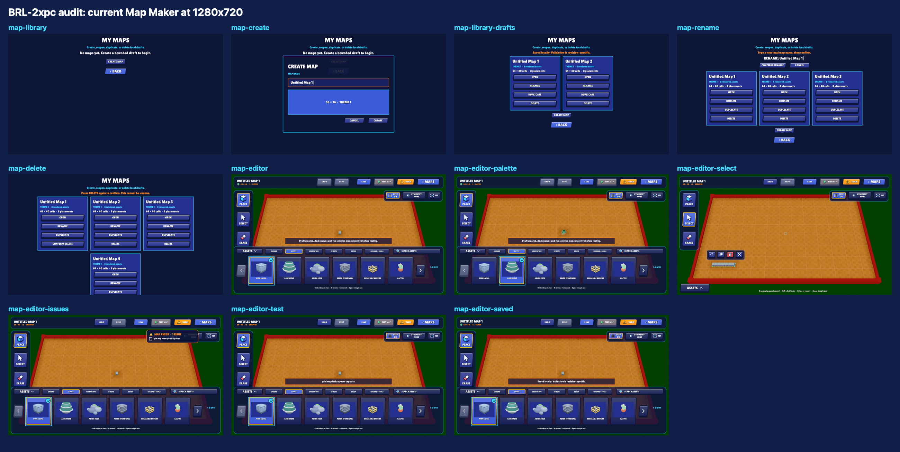
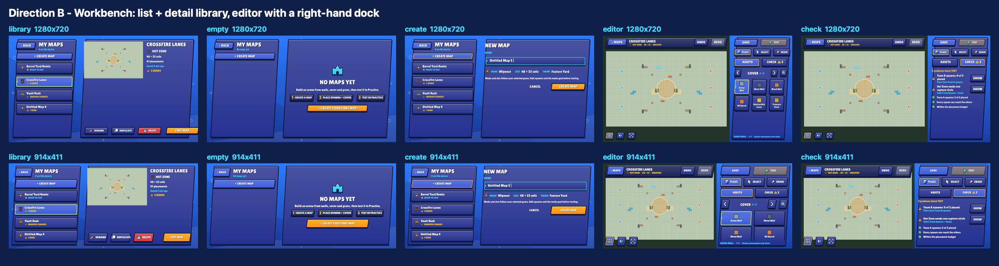
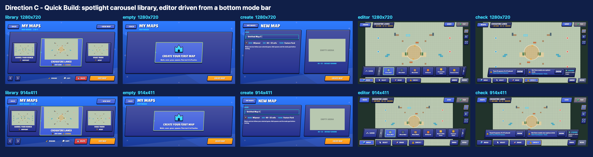

# Origin

Owner feedback, 2026-11-18: "the map maker UI is very poor and needs a complete overhaul". This comes before the incremental Map Maker improvements (BRL-8q4c phone layout, BRL-tztp advanced tools, BRL-qq21 My Maps style), which should be re-scoped against the new design or folded into it.

# Current state

- The library (`map-library`) and editor (`map-editor`, `map-editor-palette`) can be captured natively with `just shell-capture`; the BRL-pw9k sheets in `target/pw9k/` show the current look.
- The library is plain centered text on a dark background with tiny buttons. The editor is a dense toolbar plus an asset drawer, and Map Maker is exempt from the 48 dp touch-target policy (BRL-q148).
- Shipped scope and behaviour: BRL-6vjz (bounded builder), BRL-cwm9 and BRL-kgba (retained UI nodes), BRL-yaa4 (dead readout removed).

# Approach (design first)

1. Audit the current flows (library, create/rename, editor tools, palette, validation issues, test map, save) and list the problems with captures.
2. Produce 2–3 layout directions as mockups or gallery states using the shell toolkit (`Surface` roles, shell font, `spawn_action`, touch targets). Cover desktop 1280x720 and phone 914x411. Ask the owner to choose with a Ticket question.
3. Implement the chosen design. Keep the authoritative map recipe, validation and undo model unchanged; this is presentation and interaction only.

# Acceptance

- The owner approves the design direction (question) and the final native captures.
- `just shell-capture map-library map-editor` at both sizes shows the new UI; every control meets the touch-target policy on phones.
- Existing Map Maker tests pass and are updated for the new structure; `just lint`, `just test`.
- Pixel 8a playtest: create, edit, validate and test-play a map by touch.

# Design phase (2026-11-19)

## Audit of the current Map Maker

Captured natively and off-screen with `just shell-capture` (`BRAWLER_SHELL_CAPTURE_BIND=127.0.0.1:5061`, `BRAWLER_SHELL_CAPTURE_DIR=target/2xpc/audit`) at 1280x720 and 914x411. Eight audit routes were added to the capture driver so every flow can be reproduced: `map-create`, `map-library-drafts`, `map-rename`, `map-delete`, `map-editor-select`, `map-editor-issues`, `map-editor-test` and `map-editor-saved`, beside the existing `map-library`, `map-editor` and `map-editor-palette`. Contact sheets: `target/2xpc/sheets/audit-1280x720.png` and `audit-914x411.png` (attached). Per-route PNG and JSON files are in `target/2xpc/audit/<size>/`.

Problems, worst first:

1. **The library is not a shell screen** (`map-library`, `map-library-drafts`). It shows plain centered text on flat `INK`, with no `Surface::Panel`, no shell background and no titled panel. CREATE MAP and BACK are 38 px bars, 19–25 dp on the phone, and BACK sits under CREATE instead of top-left like every other screen.
2. **The library overflows at desktop size** (`map-delete` 1280x720). With 4 drafts, the 300 px cards wrap to a second row, and that row, CREATE MAP and BACK go below the window. The root does not scroll. On the phone 4 cards fit in one row only because they shrink, and a fifth draft wraps off-screen.
3. **Cards are button stacks, not maps.** Each card repeats four equal-weight bars (OPEN, RENAME, DUPLICATE, DELETE), so 4 maps give 16 identical buttons. OPEN is not primary and DELETE is not visibly destructive. The card shows developer text ("THEME 1 · 8 rendered assets") instead of an overview, mode or status (saved, needs check, ready to test).
4. **Rename and delete are detached from their card** (`map-rename`, `map-delete`). Rename is a text line ("RENAME: Untitled Map 1|") above the grid, with no field and no link to the card. Delete confirmation only relabels the button and adds a status line.
5. **The create dialog is mostly an empty box, and its preview is wrong** (`map-create`). The large blue panel says "56 × 36 · THEME 1", but the created map is 64 × 40. `create_map_panel` reads `catalog.presets.first()`, while `create_default_document` uses the selected game's first Practice preset. The dialog shows no mode, and the library's CREATE MAP and BACK show through behind it.
6. **The editor's priorities are unclear** (`map-editor`). Back ("MAPS") is at the far right of the top bar, and the disabled TEST MAP looks almost the same as the enabled actions. "1 ISSUE" is an orange pill in the same row as Save and Test.
7. **Phone editor controls are hidden and tiny** (914x411 `map-editor*`). The ERASE tool is under the asset tray, so it cannot be reached. Category tabs are about 26 dp tall, the hint line is about 7 dp, and the select toolbar's icon-only buttons are about 30 dp. The top bar, tool rail and tray take about 60 % of the height. Every control is `TouchTarget::exempt()`.
8. **Validation is a raw string** (`map-editor-issues`, `map-editor-test`). The popover shows one validator message ("grid map lacks spawn capacity") next to an unchecked-checkbox glyph that looks like a to-do item, and it covers the GRID and SYMMETRY controls. It shows no spawn or goal counts and offers no way to jump to the problem. A refused Test only shows the same raw text in a status toast.
9. **Status toasts cover the middle of the canvas** above the tray (`map-editor`, `map-editor-saved`), where the player is building.

## Design directions

Built as a UI-gallery design board from production shell pieces: `Surface` roles and states, `theme::font()`, `spawn_action`, and the `TouchTarget` floor enabled for the phone board. Every phone control is authored at least 76 UI px tall (48 dp at the 411/640 viewport fit). The code is `packages/brawler-client/src/flow/screens/map_maker_mockups.rs` (automation feature only). Render it off-screen with `BRAWLER_UI_GALLERY_SIZE=<WxH> BRAWLER_UI_GALLERY_MOCKUPS=<dir> target/debug/brawler-ui-gallery`.

Each direction shows the library, the empty library, create, the editor (Place) and the map check, at 1280x720 and 914x411. The canvas is drawn with a map overview plus a grid as a stand-in; in production it stays the live 3D arena. The sample maps and issue wording are illustrative.

All three directions:

- Give My Maps a titled `Surface::Panel` with Back top-left, a primary create action and an explicit empty state (the My Maps half of BRL-qq21).
- Keep every library and editor control at least 48 dp on the phone, with nothing hidden or overlapping (BRL-8q4c).
- Label status with an icon plus words: ready to test, N issues, unsaved changes.
- Put the editor's Back at the top-left and give Test the primary role, visibly disabled while checks fail.
- Show the map check as requirements plus fixes, not a raw string.
- Keep the authoritative recipe, validation and undo model unchanged.

### A — Shelf (`target/2xpc/sheets/direction-a-shelf.png`)

- **Library:** one large titled panel with a horizontal shelf of map cards (overview, name, mode pennant, size, status). A single action bar acts on the focused card: RENAME, DUPLICATE, DELETE and EDIT MAP (primary). Create is a modal panel over the dimmed shelf.
- **Editor:** a cleaned-up version of today's floating chrome. Top bar: MAPS, name and status, UNDO, REDO, SAVE, issues, TEST. Left tool rail and right view rail. Bottom asset tray: category tabs and an asset strip on desktop, a COVER category button and a strip on the phone. The check is a popover under the issues button.
- **Trade-offs:** closest to the shipped editor (lowest rework and retest risk), and the shelf scans well with few maps. On the phone the top bar and tray leave only about 55 % of the height for the arena. The shelf scrolls sideways, which gets slow past about 8 maps. Cards need a recipe-derived overview thumbnail, which is new presentation-cache work.

### B — Workbench (`target/2xpc/sheets/direction-b-workbench.png`)

- **Library:** list + detail. The left panel has the title, Back, CREATE MAP and a scrolling list of map rows (pennant, name, status). The right panel shows the selected map's large overview, facts (mode, size, placements, last saved), status, and RENAME, DUPLICATE, DELETE and EDIT MAP. Empty and create states take over the right panel, with no modal.
- **Editor:** the arena fills the full height on the left, with a slim name, UNDO and REDO bar and GRID, MIRROR and FIT in the corner. A right-hand dock (33 % desktop, 40 % phone) holds SAVE and TEST, the three tools as a segmented row, and ASSETS / CHECK tabs. The Assets tab has a category stepper, an asset grid (3 columns desktop, 2 phone) and the selected asset's facts. The Check tab lists what blocks Test, each with SHOW, then what passed.
- **Trade-offs:** suits a landscape phone, which has width to spare but little height. The arena keeps the full height, and all controls live in one thumb-side column. The list scales to many maps and works naturally with a controller (up/down list, detail actions). The check has room for requirement counts. The cost: the arena is narrower (about 60–67 % of the width), and it is the biggest structural change to the editor shell. The dock replaces the bottom tray, so the palette needs a vertical, scrolling grid.

### C — Quick Build (`target/2xpc/sheets/direction-c-quick-build.png`)

- **Library:** a Practice-map-picker-style spotlight. One large focused map in a titled panel, with its neighbours dimmed, ‹ › arrows, RENAME, COPY and DELETE, and a large EDIT MAP. + NEW MAP is top-right. The empty state is a single "Create your first map" card. Create is a full-screen step: the form on the left, a blank-arena preview on the right.
- **Editor:** the arena fills the screen. MAPS and an identity pill sit top-left, SAVE and TEST top-right, and the view buttons on the right edge. A bottom mode bar (BUILD, SELECT, ERASE, CHECK, plus UNDO and REDO) drives a contextual tray above it: assets in BUILD, issue cards in CHECK.
- **Trade-offs:** the most game-like, and it matches the approved Practice map picker. All frequent actions sit in the bottom thumb zone, and merging tools and checking into one mode bar is the simplest model. The carousel shows only one map at a time, so it is slow to scan or manage many drafts. Two stacked bottom rows cover the lower third of the arena on the phone, and the issue tray has room for about two issues.

### What any direction adds beyond today's presentation (no recipe, validation or undo change)

- A recipe-derived 2D overview thumbnail per draft. It is a disposable presentation cache, as the BRL-6vjz spec allows. A uses it most, C a lot, B in one place.
- Requirement counts in the check (for example "Team B spawns: 0 of 3"). These are read-only facts derived from the recipe and the selected roster. The authoritative validator still decides admission. SHOW appears only where the issue names a cell or placement.
- Fixing the create preview to use the same preset as `create_default_document` (problem 5).

**Recommendation: B — Workbench.** It solves the phone height problem structurally rather than by shrinking. It gives the library a list that scales, a proper detail panel and an empty state. It gives the check room for counts and fixes. It also leaves room for BRL-tztp's extra tools (more segmented tool buttons, or a TOOLS tab) without crowding the arena. A's library shelf could pair with B's editor if the owner prefers cards over a list.

### Sheets

