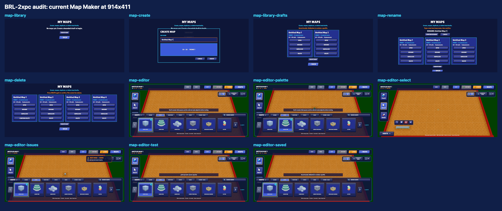
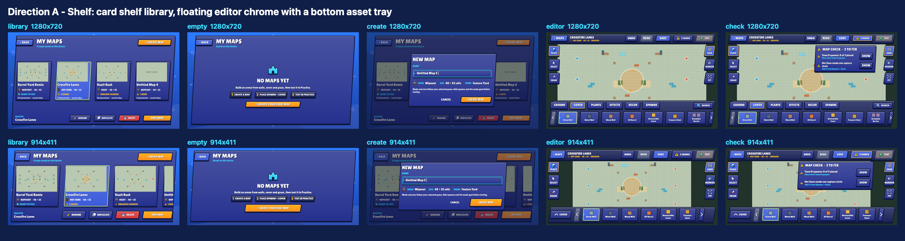
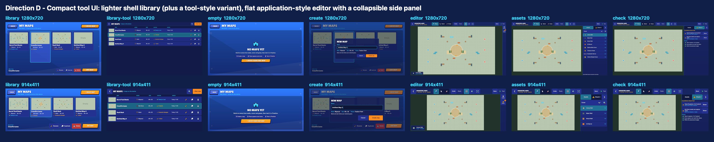
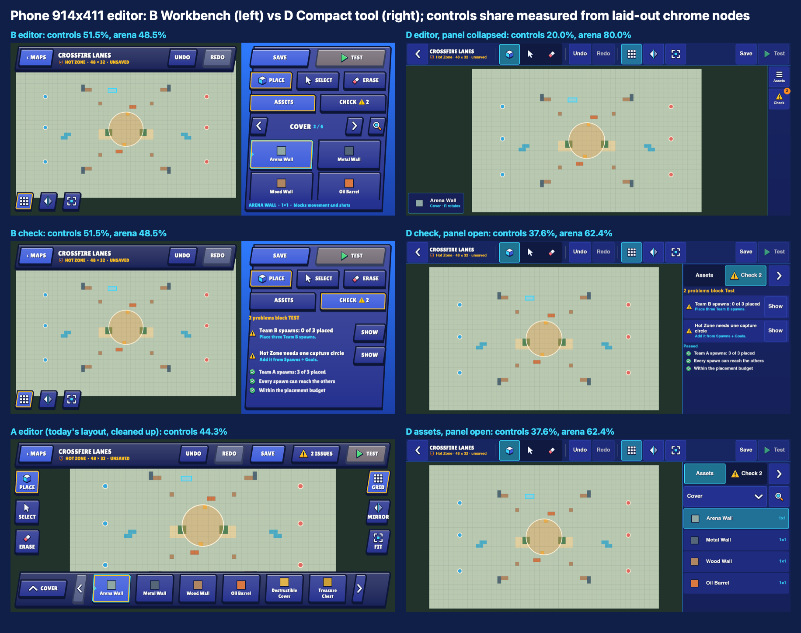
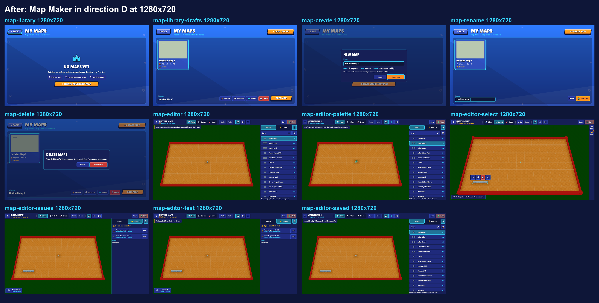
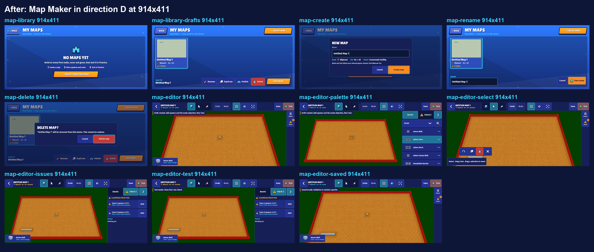
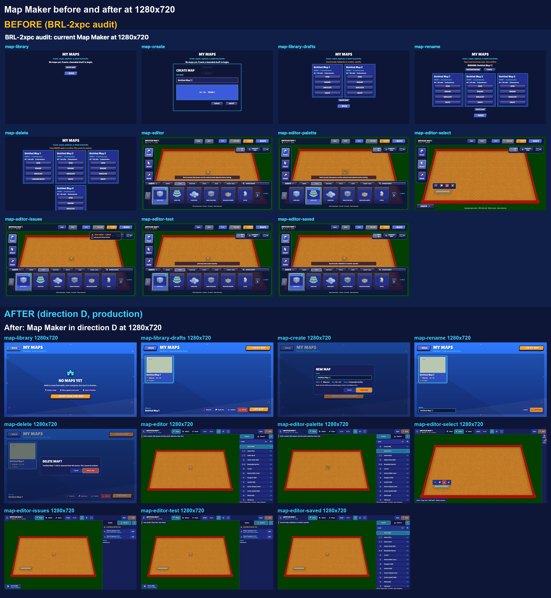
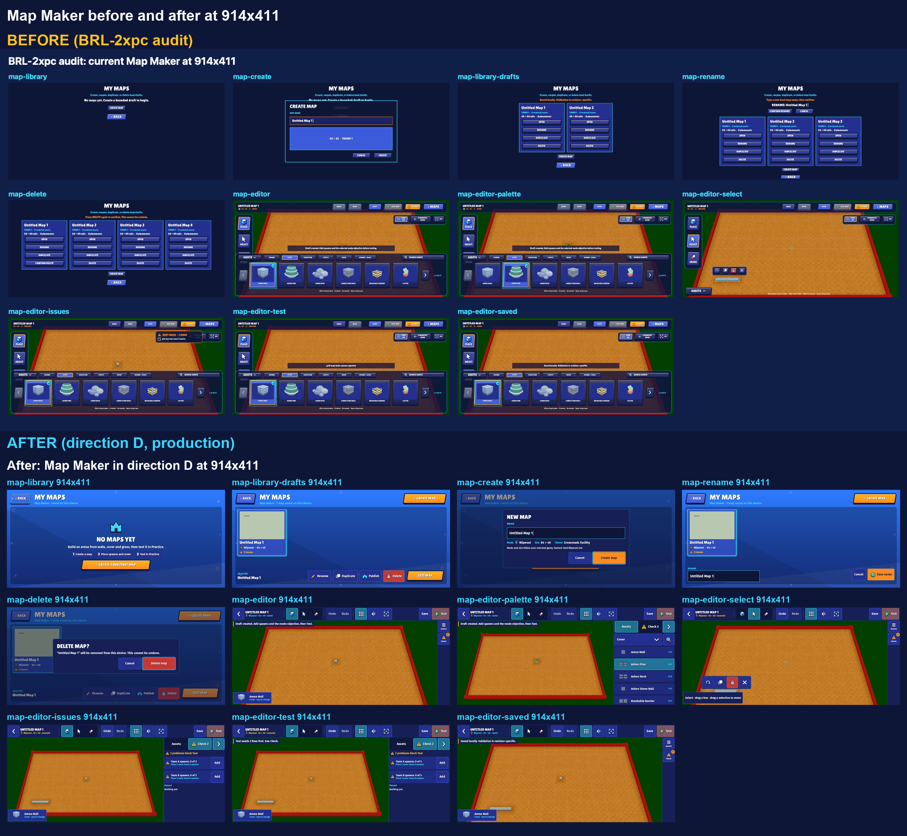

# Origin

Owner feedback, 2026-11-18: "the map maker UI is very poor and needs a complete overhaul". This comes before the incremental Map Maker improvements (BRL-8q4c phone layout, BRL-tztp advanced tools, BRL-qq21 My Maps style), which should be re-scoped against the new design or folded into it.

# Current state

- The library (`map-library`) and editor (`map-editor`, `map-editor-palette`) can be captured natively with `just shell-capture`; the BRL-pw9k sheets in `target/pw9k/` show the current look.
- The library is plain centered text on a dark background with tiny buttons. The editor is a dense toolbar plus an asset drawer, and Map Maker is exempt from the 48 dp touch-target policy (BRL-q148).
- Shipped scope and behaviour: BRL-6vjz (bounded builder), BRL-cwm9 and BRL-kgba (retained UI nodes), BRL-yaa4 (dead readout removed).

# Approach (design first)

1. Audit the current flows (library, create/rename, editor tools, palette, validation issues, test map, save) and list the problems with captures.
2. Produce 2–3 layout directions as mockups or gallery states using the shell toolkit (`Surface` roles, shell font, `spawn_action`, touch targets). Cover desktop 1280x720 and phone 914x411. Ask the owner to choose with a Ticket question.
3. Implement the chosen design. Keep the authoritative map recipe, validation and undo model unchanged; this is presentation and interaction only.

# Acceptance

- The owner approves the design direction (question) and the final native captures.
- `just shell-capture map-library map-editor` at both sizes shows the new UI; every control meets the touch-target policy on phones.
- Existing Map Maker tests pass and are updated for the new structure; `just lint`, `just test`.
- Pixel 8a playtest: create, edit, validate and test-play a map by touch.

# Design phase (2026-11-19)

## Audit of the current Map Maker

Captured natively and off-screen with `just shell-capture` (`BRAWLER_SHELL_CAPTURE_BIND=127.0.0.1:5061`, `BRAWLER_SHELL_CAPTURE_DIR=target/2xpc/audit`) at 1280x720 and 914x411. Eight audit routes were added to the capture driver so every flow can be reproduced: `map-create`, `map-library-drafts`, `map-rename`, `map-delete`, `map-editor-select`, `map-editor-issues`, `map-editor-test` and `map-editor-saved`, beside the existing `map-library`, `map-editor` and `map-editor-palette`. Contact sheets: `target/2xpc/sheets/audit-1280x720.png` and `audit-914x411.png` (attached). Per-route PNG and JSON files are in `target/2xpc/audit/<size>/`.

Problems, worst first:

1. **The library is not a shell screen** (`map-library`, `map-library-drafts`). It shows plain centered text on flat `INK`, with no `Surface::Panel`, no shell background and no titled panel. CREATE MAP and BACK are 38 px bars, 19–25 dp on the phone, and BACK sits under CREATE instead of top-left like every other screen.
2. **The library overflows at desktop size** (`map-delete` 1280x720). With 4 drafts, the 300 px cards wrap to a second row, and that row, CREATE MAP and BACK go below the window. The root does not scroll. On the phone 4 cards fit in one row only because they shrink, and a fifth draft wraps off-screen.
3. **Cards are button stacks, not maps.** Each card repeats four equal-weight bars (OPEN, RENAME, DUPLICATE, DELETE), so 4 maps give 16 identical buttons. OPEN is not primary and DELETE is not visibly destructive. The card shows developer text ("THEME 1 · 8 rendered assets") instead of an overview, mode or status (saved, needs check, ready to test).
4. **Rename and delete are detached from their card** (`map-rename`, `map-delete`). Rename is a text line ("RENAME: Untitled Map 1|") above the grid, with no field and no link to the card. Delete confirmation only relabels the button and adds a status line.
5. **The create dialog is mostly an empty box, and its preview is wrong** (`map-create`). The large blue panel says "56 × 36 · THEME 1", but the created map is 64 × 40. `create_map_panel` reads `catalog.presets.first()`, while `create_default_document` uses the selected game's first Practice preset. The dialog shows no mode, and the library's CREATE MAP and BACK show through behind it.
6. **The editor's priorities are unclear** (`map-editor`). Back ("MAPS") is at the far right of the top bar, and the disabled TEST MAP looks almost the same as the enabled actions. "1 ISSUE" is an orange pill in the same row as Save and Test.
7. **Phone editor controls are hidden and tiny** (914x411 `map-editor*`). The ERASE tool is under the asset tray, so it cannot be reached. Category tabs are about 26 dp tall, the hint line is about 7 dp, and the select toolbar's icon-only buttons are about 30 dp. The top bar, tool rail and tray take about 60 % of the height. Every control is `TouchTarget::exempt()`.
8. **Validation is a raw string** (`map-editor-issues`, `map-editor-test`). The popover shows one validator message ("grid map lacks spawn capacity") next to an unchecked-checkbox glyph that looks like a to-do item, and it covers the GRID and SYMMETRY controls. It shows no spawn or goal counts and offers no way to jump to the problem. A refused Test only shows the same raw text in a status toast.
9. **Status toasts cover the middle of the canvas** above the tray (`map-editor`, `map-editor-saved`), where the player is building.

## Design directions

Built as a UI-gallery design board from production shell pieces: `Surface` roles and states, `theme::font()`, `spawn_action`, and the `TouchTarget` floor enabled for the phone board. Every phone control is authored at least 76 UI px tall (48 dp at the 411/640 viewport fit). The code is `packages/brawler-client/src/flow/screens/map_maker_mockups.rs` (automation feature only). Render it off-screen with `BRAWLER_UI_GALLERY_SIZE=<WxH> BRAWLER_UI_GALLERY_MOCKUPS=<dir> target/debug/brawler-ui-gallery`.

Each direction shows the library, the empty library, create, the editor (Place) and the map check, at 1280x720 and 914x411. The canvas is drawn with a map overview plus a grid as a stand-in; in production it stays the live 3D arena. The sample maps and issue wording are illustrative.

All three directions:

- Give My Maps a titled `Surface::Panel` with Back top-left, a primary create action and an explicit empty state (the My Maps half of BRL-qq21).
- Keep every library and editor control at least 48 dp on the phone, with nothing hidden or overlapping (BRL-8q4c).
- Label status with an icon plus words: ready to test, N issues, unsaved changes.
- Put the editor's Back at the top-left and give Test the primary role, visibly disabled while checks fail.
- Show the map check as requirements plus fixes, not a raw string.
- Keep the authoritative recipe, validation and undo model unchanged.

### A — Shelf (`target/2xpc/sheets/direction-a-shelf.png`)

- **Library:** one large titled panel with a horizontal shelf of map cards (overview, name, mode pennant, size, status). A single action bar acts on the focused card: RENAME, DUPLICATE, DELETE and EDIT MAP (primary). Create is a modal panel over the dimmed shelf.
- **Editor:** a cleaned-up version of today's floating chrome. Top bar: MAPS, name and status, UNDO, REDO, SAVE, issues, TEST. Left tool rail and right view rail. Bottom asset tray: category tabs and an asset strip on desktop, a COVER category button and a strip on the phone. The check is a popover under the issues button.
- **Trade-offs:** closest to the shipped editor (lowest rework and retest risk), and the shelf scans well with few maps. On the phone the top bar and tray leave only about 55 % of the height for the arena. The shelf scrolls sideways, which gets slow past about 8 maps. Cards need a recipe-derived overview thumbnail, which is new presentation-cache work.

### B — Workbench (`target/2xpc/sheets/direction-b-workbench.png`)

- **Library:** list + detail. The left panel has the title, Back, CREATE MAP and a scrolling list of map rows (pennant, name, status). The right panel shows the selected map's large overview, facts (mode, size, placements, last saved), status, and RENAME, DUPLICATE, DELETE and EDIT MAP. Empty and create states take over the right panel, with no modal.
- **Editor:** the arena fills the full height on the left, with a slim name, UNDO and REDO bar and GRID, MIRROR and FIT in the corner. A right-hand dock (33 % desktop, 40 % phone) holds SAVE and TEST, the three tools as a segmented row, and ASSETS / CHECK tabs. The Assets tab has a category stepper, an asset grid (3 columns desktop, 2 phone) and the selected asset's facts. The Check tab lists what blocks Test, each with SHOW, then what passed.
- **Trade-offs:** suits a landscape phone, which has width to spare but little height. The arena keeps the full height, and all controls live in one thumb-side column. The list scales to many maps and works naturally with a controller (up/down list, detail actions). The check has room for requirement counts. The cost: the arena is narrower (about 60–67 % of the width), and it is the biggest structural change to the editor shell. The dock replaces the bottom tray, so the palette needs a vertical, scrolling grid.

### C — Quick Build (`target/2xpc/sheets/direction-c-quick-build.png`)

- **Library:** a Practice-map-picker-style spotlight. One large focused map in a titled panel, with its neighbours dimmed, ‹ › arrows, RENAME, COPY and DELETE, and a large EDIT MAP. + NEW MAP is top-right. The empty state is a single "Create your first map" card. Create is a full-screen step: the form on the left, a blank-arena preview on the right.
- **Editor:** the arena fills the screen. MAPS and an identity pill sit top-left, SAVE and TEST top-right, and the view buttons on the right edge. A bottom mode bar (BUILD, SELECT, ERASE, CHECK, plus UNDO and REDO) drives a contextual tray above it: assets in BUILD, issue cards in CHECK.
- **Trade-offs:** the most game-like, and it matches the approved Practice map picker. All frequent actions sit in the bottom thumb zone, and merging tools and checking into one mode bar is the simplest model. The carousel shows only one map at a time, so it is slow to scan or manage many drafts. Two stacked bottom rows cover the lower third of the arena on the phone, and the issue tray has room for about two issues.

### What any direction adds beyond today's presentation (no recipe, validation or undo change)

- A recipe-derived 2D overview thumbnail per draft. It is a disposable presentation cache, as the BRL-6vjz spec allows. A uses it most, C a lot, B in one place.
- Requirement counts in the check (for example "Team B spawns: 0 of 3"). These are read-only facts derived from the recipe and the selected roster. The authoritative validator still decides admission. SHOW appears only where the issue names a cell or placement.
- Fixing the create preview to use the same preset as `create_default_document` (problem 5).

**Recommendation: B — Workbench.** It solves the phone height problem structurally rather than by shrinking. It gives the library a list that scales, a proper detail panel and an empty state. It gives the check room for counts and fixes. It also leaves room for BRL-tztp's extra tools (more segmented tool buttons, or a TOOLS tab) without crowding the arena. A's library shelf could pair with B's editor if the owner prefers cards over a list.

### Sheets

### D — Compact tool UI (`target/2xpc/sheets/direction-d-compact-tool.png`), added 2026-11-19

Owner feedback, 2026-11-19: the wide slanted buttons suit the game shell, but Map Maker is fundamentally an application. Large, decorative controls waste space, especially on a phone. D explores standard GUI components that keep the shell's colours.

- **Kept from the shell:**
  - the palette: navy panels, cyan focus and selection, orange primary;
  - the Lilita title font;
  - 48 dp phone targets (76 UI px at 914x411).
- **Editor:**
  - **No shell surfaces:** no slants, lips, drop shadows or full-width text bars.
  - **Thin top bar** (`ctl` + 8 px tall), all square icon buttons:
    - Back;
    - document name and status;
    - Place, Select and Erase as one segmented control (icon only on the phone, icon plus a short label on desktop);
    - Undo and Redo;
    - Grid, Mirror and Fit;
    - Save and Test (orange; disabled while checks fail).
  - **Side panel for Assets and Check:**
    - open, it is 400 px wide on the phone (330 px on desktop), with segmented tabs and a collapse button;
    - collapsed, it shrinks to two tab buttons, and Check carries an orange count badge;
    - collapsed, a chip in the corner shows the current asset ("Arena Wall · Cover · R rotates");
    - Assets: a category picker, search, and compact rows (swatch, name, footprint) with the selection shown as a cyan fill and outline;
    - Check: issue rows, each with Show, then what passed.
  - **Body text** uses the platform sans (`FontSource::SansSerif`, weight 600). Titles stay in Lilita.
- **Library:**
  - **The lighter-shell look (main frames):** the shell background, shell Back, title, orange CREATE MAP and EDIT MAP, and flat map tiles inside a translucent `ink` panel. Rename, Duplicate and Delete are flat buttons acting on the selected tile. Create is a flat dialog.
  - **The tool-style variant (`library-tool`):** a thin top bar and a table of maps (thumbnail, name, mode, size, status, saved time, and inline rename, duplicate and delete icons).
- **Measured control coverage** on the phone (914x411):

  | Direction | Controls cover | Arena keeps |
  |---|---|---|
  | D, panel collapsed | 20.0 % | 80 % |
  | D, panel open | 37.6 % | 62 % |
  | A | 44.3 % (61 % with the check open) | 56 % |
  | B | 51.5 % | 48.5 % |
  | C | 43.2 % | 57 % |

  The board writes these numbers to `target/2xpc/board/<size>/arena-share.txt`. They are the summed layout areas of the editor's control containers (`ChromeRegion`) over the screen. The desktop figures are D 10.9 % / 30.7 %, B 41.7 %, A 44.4 %, C 32.5 %.
- **Comparison sheet:** `target/2xpc/sheets/compare-b-vs-d-phone.png` shows B and D side by side on the phone: the editor, the check, and D's open Assets panel, with A for reference.
- **Trade-offs:**
  - **For:**
    - the arena gets about 80 % of the phone screen, and every control is still 48 dp;
    - flat controls are simpler to build and test, because they skip the slant, lip and focus-geometry reserves;
    - long asset lists scroll naturally;
    - the panel has room for BRL-tztp's extra tools.
  - **Against:**
    - the editor deliberately stops looking like the shell (a "game" vs "tool" split);
    - controller focus needs a local flat focus ring, because the shell surface's focus frame doesn't apply;
    - the system sans differs between macOS (Helvetica Neue) and Android (Roboto);
    - D's widgets stay local to Map Maker and are not added to the shell toolkit, per the brief.
- **Implementation note if D is chosen:** the flat widgets live in Map Maker's own module, next to its screen, and are not a `Surface` variant. Map Maker's buttons still get the touch-target floor through `FlowButton`/`TouchTarget`.

**Updated recommendation: D, with the lighter-shell library.** The owner's critique holds up when measured. Shell-styled controls at 48 dp cost B about half the phone screen; D's flat controls cost 20 % collapsed and 38 % open. My Maps keeps the shell look, so Map Maker's entry still feels like part of the game. The tool-style library is the alternative if one consistent tool look throughout Map Maker matters more. The question `q-ad0c83c` was edited in place to offer A, B, C, D, and D with the tool-style library.

# Implementation: direction D (2026-11-19)

The owner chose D, "Compact tool UI, with the lighter-shell library" (q-ad0c83c). This also delivers BRL-8q4c. Presentation and interaction only: the map recipe, `validate_authored_recipe` and the undo model are unchanged.

## What was built

- **Module layout:** `flow/screens/map_maker.rs` keeps state, action resolution and input. The views are new submodules:
  - `map_maker/library.rs`: My Maps.
  - `map_maker/editor.rs`: the editor.
  - `map_maker/widgets.rs`: the flat D controls. They stay local to Map Maker; no shell-toolkit variant was added.
  - `map_maker/check.rs`: the map check.
  - `map_maker/scroll.rs`: the Map Maker scroll areas.
- **My Maps (lighter shell):**
  - Shell background, shell Back, MY MAPS title with a saved-count subtitle, and an orange + CREATE MAP. Flat map tiles sit in a translucent `ink` panel.
  - Each tile shows a recipe-derived overview, the name, the mode pennant, mode and size, and its check status ("Ready to test" or "N issues"). The overview is a disposable flat drawing: placements, filled rects, spawns and objectives in palette colours. It is not cached.
  - Tapping a tile selects it, and tapping the selected tile opens it. The selected map's bar holds Rename, Duplicate, Publish (BRL-w9z1, kept and restyled), Delete and the orange EDIT MAP.
  - Rename happens in place in that bar: a real text field with a caret, typing updates it without a rebuild, plus Cancel and Save name.
  - Delete opens a proper confirmation dialog ("“Name” will be removed from this device. This cannot be undone.") with Cancel and Delete map.
  - Empty state: NO MAPS YET, three steps and + CREATE YOUR FIRST MAP.
  - The tiles scroll (wheel, touch drag, focus reveal). The scroll position survives rebuilds.
  - Publish outcomes and errors show on a status line at the top of the panel.
- **Create dialog:** a flat dialog on its own UI layer. It has the name field, then Mode (with pennant), Size and Theme, and "Mode and size follow your selected game, <game>." When the server offers no defaults, the reason shows and Create is disabled.
  - **Audit bug fixed:** the dialog and `create_default_document` now share `create_defaults()`, the selected game's first Practice preset. The preview no longer reads `catalog.presets.first()`.
- **Editor:**
  - **Thin top bar:** Back, the map name and status ("Hot Zone · 64 × 40 · unsaved", plus " · mirror left / right" when mirroring is on), Place/Select/Erase as one segmented control (labels on desktop, icons only on the phone), Undo, Redo, Grid, Mirror, Fit, Save, and an orange Test.
  - **Test while the check fails:** Test is muted but still pressable. Pressing it opens Check and says "Test needs N fixes first. See Check."
  - **Side panel:** a collapsible Assets/Check panel, 330 px wide on desktop and 400 UI px on the phone, with segmented tabs and a collapse button.
    - Collapsed, it is two tabs; Check carries an orange count badge.
    - Assets has a category picker (a dropdown list), search with a real field and Clear, and compact rows (footprint swatch, name, footprint). The selection is a cyan fill and outline.
  - **Corner chip:** shows the current asset as a live 3D preview, its name, and "Cover · R rotates" (phone: "tap to change"). It updates in place when the asset cycles. With Select or Erase active, a tool hint replaces it.
  - **Check:** a summary, then issue rows with requirement counts ("Team B spawns: 0 of 3") and advice. Each row has an **Add** action that opens Assets on the entry that fixes it: right category, search cleared, Place tool. A validator refusal not explained by the counts shows as its own row. Below that, what passed.
  - **Arena framing:** the arena camera draws only below the top bar and left of the side panel. Its viewport follows the laid-out chrome (`MapEditorArenaInsets`), so the map fits the free area.
  - **Status messages:** a compact toast under the top bar's left edge, no longer in the middle of the canvas.
  - **Selection toolbar:** flat squares for Rotate, Duplicate, Delete and Clear, kept below the top bar.
  - **Erase on phones:** reachable in the top bar's segmented control.
- **Panel defaults:** a draft opens with Assets on desktop and collapsed on a phone-sized window.
  - Switching to Select or Erase collapses Assets; Check stays open.
  - Picking a category opens Assets.
  - Esc closes the category menu or Check before it leaves.
- **Font:**
  - Titles: the shell's Lilita One.
  - Body text: **Fira Sans Bold**, bundled as `assets/brawler/ui/fonts/fira-sans-bold.ttf`. It is OFL-1.1, Mozilla/Telefonica, taken from Bevy's `bevy_feathers` assets, and recorded in the manifest, `THIRD_PARTY.md`, the license text `FiraSans-OFL-1.1.txt` and Credits.
  - Why: the design board used `FontSource::SansSerif` at weight 600, the platform sans. That is Helvetica Neue on macOS and Roboto on Android, so it renders differently. A bundled face renders the same on both.
  - Bold was picked as the nearest bundled weight to the board's 600.
- **Focus:**
  - The flat controls draw a 3 px `accent` focus ring, offset 2 px. It is the flat counterpart of BRL-fe7t's inset accent frame, and it follows the same `FocusVisibility` rule: a touch press hides it, and keys, the D-pad or the mouse show it again.
  - My Maps has keyboard and controller navigation: arrows and the D-pad move to the nearest control in that direction, and Enter, Space or South activates it. While a dialog is open, only its buttons take focus.
  - The shell-surface actions (Back, Create, Edit) keep the shell focus frame.
  - The editor keeps its existing keyboard and controller shortcuts, and its controls take no focus. Controller navigation of the editor toolbar is deferred.
- **Touch targets:**
  - `TouchTarget::exempt()` is removed from Map Maker, and from the code entirely, since it had no other user. The unused `SurfaceStyle::MAP_*` shell geometry is also retired.
  - Compact controls are authored at 48 dp: `ctl = max(76, ceil(48 / UiScale))` UI px whenever the window is under 640 logical px tall or touch is on, so the Android floor never resizes the layout.
  - The flat controls are `FlowButton`s, so they still get the floor and release activation.
- **Android keyboard:** a new `TextEntryField::AssetSearch` lets the Android on-screen keyboard type into asset search.
- **Board cleanup:** the design board (`map_maker_mockups/`) and the gallery's `BRAWLER_UI_GALLERY_MOCKUPS` mode are deleted. The sheets stay attached.
  - The audit capture routes stay and show the new screens.
  - `map-editor-palette` now opens Assets on Cover and cycles to the next asset.
  - `map-editor-issues` opens the Check panel.

## Arena share (measured like the board)

The measure is the summed laid-out areas of the editor's control containers (top bar, side panel, corner chip) over the screen, with the panel collapsed. The test `flow::tests::map_editor_controls_leave_the_arena_most_of_a_landscape_phone` checks and prints it.

| Size | Controls | Arena | Board |
|---|---|---|---|
| 914x411 (phone) | 19.6 % | 80.4 % | 20.0 % |
| 1280x720 (desktop) | 11.0 % | 89.0 % | 10.9 % |

## Decisions

- **Add rather than Show:** Check's per-issue action is labelled **Add**. A missing spawn or objective has no place on the map to show; what helps is the asset that fixes it. Locating validator rule errors on the map is deferred to BRL-855z, because the validator does not report cells.
- **Test stays pressable:** the board drew Test as disabled. Production keeps it pressable and muted, so that a refused Test can point to Check, as required.
- **Category picker:** a dropdown list inside the panel, not chips.
- **Asset rows:** a flat footprint swatch in the category colour. The single live 3D preview lives in the corner chip and follows the selection without a rebuild, using one camera instead of one per row.
- **Library tiles:** the overview is drawn from the recipe as flat UI nodes, at most 320 items. There is no render-to-texture and no cache.
- **Retired shell toolkit pieces:** `SurfaceStyle` and its `MAP_*` geometry, and `TouchTarget::exempt()`. Map Maker was their only user. No new shell-toolkit variant was added.

## Verification

- **`just lint`:** passes, with ripgrep on `PATH`.
- **`just test`:** passes. All 24 suites, 2613 tests, including the network and performance gates. No reruns were needed.
- **New and updated tests:**
  - `widgets::compact_controls_are_48_dp_at_every_ui_scale`;
  - `check::*` (requirement counts, validator readiness);
  - `library::spatial_focus_stays_in_its_row_and_column`;
  - `map_maker::tests`: panel and tool states, Check Add, asset selection and cycling without a rebuild, the chip following the selection without a rebuild, value-only edits, and key sounds;
  - `flow::tests::shell_controls_are_48_dp_touch_targets_on_a_landscape_phone`, now covering Map Maker;
  - `flow::tests::map_editor_controls_leave_the_arena_most_of_a_landscape_phone`;
  - `flow::tests::shell_capture_route_steps_match_the_reducer`.
- **Captures:** all 11 Map Maker routes at 1280x720 and 914x411, taken with `BRAWLER_SHELL_CAPTURE_BIND=127.0.0.1:5061 just shell-capture <route>`, off-screen. I looked at every capture.
  - Routes: map-library (empty), map-library-drafts, map-create, map-rename, map-delete, map-editor, map-editor-palette, map-editor-select, map-editor-issues, map-editor-test, map-editor-saved.
  - Before/after contact sheets are in `target/2xpc/final/` and attached here.
- **Phone captures and touch:** the macOS capture client runs without the Android touch policy. Compact metrics still author 48 dp controls at the phone viewport, so the 914x411 captures show the Android layout at 100 % UI scale.

## Feedback

- **Owner (2026-11-19):** "The wide slanted button work well for the game shell design but they don't work very well for what is fundamentally an application." **Implemented:** flat controls everywhere except My Maps' shell Back and primary actions.
- **Audit problems 1–9:** all implemented as described above.
  - The library is now a shell screen, with Back at the top left.
  - The library scrolls.
  - Tiles show maps, not button stacks.
  - Rename and delete work in place, with a real field and a dialog.
  - The create preview is fixed.
  - Editor priorities are clear: Back at the left, Test as the orange primary.
  - Phone controls are reachable and at least 48 dp.
  - Check shows counts and actions instead of a raw string.
  - The status toast no longer covers the canvas.

## Mistakes and prevention

- **Interim captures:** the first desktop tiles were taller than their content. In the wrapping tile grid, wrapping labels were measured at min-content width. Fixed: single-line labels use `Kit::line` (no wrap). Prevention: use no-wrap text inside auto-sized flex children in wrapping rows.
- **Test apps without assets:** test apps that run the views panicked until they called `init_asset::()`, because the views now load a bundled font handle.
- **A misgrouped local commit:** I reset and redid it before anything left the worktree.

## Deferred

- BRL-q5sm: controller focus in the editor toolbar and panel.
- BRL-855z: Show where a rule error is on the map.
- BRL-tztp: re-scoped against D in its own spec.

## Pixel playtest (Pixel 8a, landscape)

- **Run:** `BRAWLER_ROUTED_BIND=0.0.0.0:5000 just server` on the Mac, then `just android-build <mac-lan-ip>:5000` and `just android-install`.
- **Try:**
  1. My Maps: Create map. Check that the dialog shows the selected game's mode and the size you get. Then create.
  2. Editor: the panel starts collapsed and the chip shows the current asset.
  3. Tap Check, then Add on "Team A spawns: 0 of 3". Assets opens on Team A Spawn. Place three spawns by tapping, then do the same for Team B.
  4. Collapse the panel with the chevron. Switch to Erase in the top bar and drag to erase. Undo and Redo.
  5. Tap Test while the map still has issues: it should open Check. Then fix them and Test.
  6. Back in My Maps: Rename with the keyboard, Duplicate, then Delete through the dialog. Scroll the tiles with 4 or more maps.
  7. Repeat at 80 % UI scale (Settings).
- **Look for:**
  - every control comfortably tappable and nothing overlapping;
  - the arena framed in the free area, not under the panel;
  - text sharp in Fira Sans;
  - search typing through the on-screen keyboard;
  - no focus ring after taps, and the ring back after a controller press.

## Commits (branch worktree-agent-a6ed99760a650c1e4)

d17d1460 (font), 847acccb (spawn constant and asset-search field), b5ce56af (arena camera viewport), bccfdd1d (Map Maker D views and tests).

## Final sheets

`target/2xpc/final/after-1280x720.png`, `after-914x411.png`, `before-after-1280x720.png` and `before-after-914x411.png` in the worktree; attached below.

# Integration on main (2026-11-19)

- The four D commits were cherry-picked onto main (89d18cc2 and its three parents); one conflict in `shell_capture_route_steps_match_the_reducer` was resolved by keeping BRL-wqst live-route filter plus this ticket font harness.
- On main `shell_capture_route_steps_match_the_reducer` then failed deterministically (also in the agent worktree): `Map Maker library limit reached (64)`. Cause: default `MapDraftStorage` (and settings/connections paths) resolved to the real per-user config dir in tests, and flow tests had written 63 "Untitled Map" drafts there during the day. Fixed in a separate commit: `platform_dirs::config_directory()` returns a fresh temp dir per call under `cfg(test)` / `network-test`. The owner removed the polluted drafts.
- After the fix: `just lint` pass; `just test` pass (all suites); `scripts/shell-capture.sh map-editor-issues 914x411` pass; the real config dir was unchanged by a full client test run.
- Lesson: a green report from a worktree does not prove the test is environment-independent; tests must never default to player-local paths.
