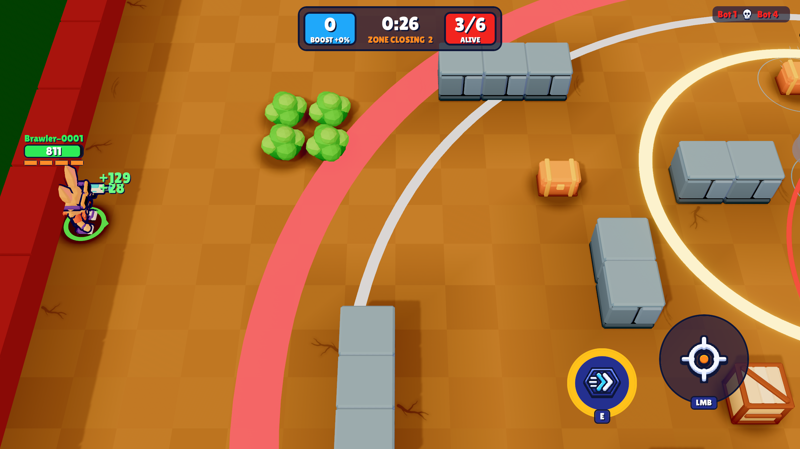
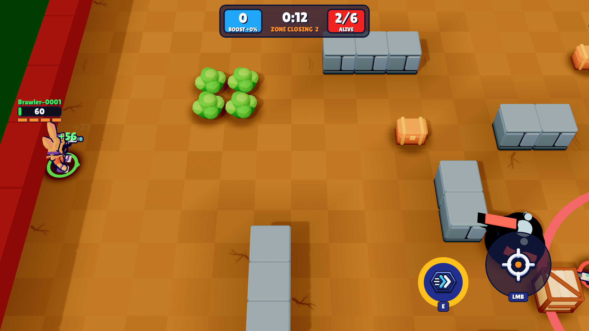

# Outcome

Players can queue or practice a short solo **Last Stand** match. Each fighter has one life, a visible server-owned boundary closes the playable space, and the last surviving fighter wins.

# Naming

BRL-wg28 (owner decision, 2026-11-20) renames Showdown to **Last Stand** everywhere: player text, the `GameMode::LastStand` variant, the `last-stand` mode key, and `last-stand-*` game-type IDs. BRL-wg28 is ordered before this ticket. If this ticket starts first anyway, it is born with the new names. "Showdown" must not appear in new code or UI.

# Scope

- Add one solo topology: N teams of one fighter, with N fixed by the owner's capacity answer (the routed ceiling is `MAX_PARTICIPANTS` = 8, `packages/brawler-routing/src/limits.rs:35`).
- Add a focused mode plugin under `src/modes/` and `src/matchplay/`, with distributed spawn requirements, elimination ranking, winner, draw, and forfeit rules, timeout, results, restart, and recovery.
- Add a deterministic closing-boundary schedule, safe-zone state, outside-zone damage, world and HUD telegraphs, and one compatible map.
- Eliminated humans enter a small observer state that cannot influence gameplay: a camera that follows a surviving fighter, then results. There is no public spectator service.
- Practice bots get survival, engagement, retreat, boundary, and chest/pickup goals, using only permitted facts and acting through their ordinary controller path.
- Adding the `GameMode` variant is the global protocol compatibility bump (`docs/08-network-architecture.md`).

# Research findings (2026-11-20)

The current match code supports only one or two teams:

- `MatchLifecycleRules` rejects team counts outside 1..=2 (`src/matchplay/server.rs:74`), and `server.rs:799` has a two-team special case.
- Team assignment is fixed at `[u8; 2]` (`src/matchplay/spawns.rs:9`). Queue formation assigns `index % team_count` (`src/server/lobby/queue.rs:1015`).
- The client HUD scoreboard, results, kill feed, and name plates assume `TeamId(0)` and `TeamId(1)` (`packages/brawler-client/src/hud/`, `flow/screens/results/`).
- Ally/enemy relationship VFX already work for free-for-all, because every other fighter is simply an enemy.

Generalising team count is therefore core scope, not a side effect. Keep it bounded: supported team counts become 1..=N with N the solo capacity. Takedown, Turf Hold, Vault Break, and Zombie keep their exact current topology, and their two-team HUD stays as it is. Solo gets its own compact standings HUD rather than a generic N-team scoreboard framework.

Existing pieces to reuse:

- Outside-zone damage goes through the existing environmental damage path (`src/combat/environment.rs`), so combat remains the only module that commits health and defeats.
- Chest pickups reuse Zombie's chest-to-boost path (see Decisions). No loot system.
- `docs/04-maps-and-game-modes.md:299` mentions twelve solo fighters. That exceeds the routed ceiling. Correct it to the chosen N.

# Build order (one ticket, reviewable steps)

1. Topology: a bounded team count of 1..=N through lifecycle rules, spawn assignment, queue formation, and admission, with regression tests proving the existing modes are unchanged.
2. Rules core: the mode variant, one life, elimination ranking, last survivor, simultaneous defeat, timeout and draw, results, and focused `App` tests.
3. Boundary: the deterministic phase schedule, the safe-zone state, and damage through `combat::environment`.
4. Map and spawns: distributed, validated spawn separation with no deterministic advantage.
5. Presentation: boundary telegraphs that stay readable with reduced effects, the standings HUD, the observer camera, and results.
6. Practice bots, routed and network tests, the N-fighter performance gate, and docs.

# Boundaries

- No team variant, battle pass, persistent loot, random item rarity, join-in-progress, public spectator service, or generic shrinking-zone framework.
- No respawn inside an active round.
- No generic N-team scoreboard for the existing modes.

# Acceptance criteria

- Death drops follow `clamp(stacks, 1, 2)` at validated reachable cells (focused tests for 0, 1, 2 and 3+ stacks, and for an outside-zone death).
- Admission, spawn separation, elimination, ranking, last survivor, simultaneous defeat, boundary phases, outside-zone damage, timeout, the observer transition, results, restart, late-join rejection, and recovery pass focused tests and `tests/network/` scenarios.
- Existing 1v1, 2v2, 3v3, and Zombie topologies pass unchanged.
- Boundary and danger feedback stay readable at the supported camera framing and with reduced effects.
- The map supports early exploration, mid-match engagement, and final convergence without a deterministic spawn advantage.
- The N-fighter routed capacity and performance gates pass, and Practice bots handle the boundary.
- `docs/04-maps-and-game-modes.md` is updated: the mode moves to supported, and the solo capacity line is corrected. Learning notes are recorded here.

# Verification

- `just lint` and `just test`
- `just practice-e2e last-stand-<N>p` and `just rejoin-e2e last-stand-<N>p`
- `just e2e <N>`, or the routed matrix, at the chosen capacity
- `just v3-render-evidence` with `BRAWLER_RENDER_GAME_TYPE=last-stand-<N>p` at full capacity, with captures attached (a mid-match frame and a late-boundary frame)

# Playtest notes (owner, after done)

This is not a gate for done. The agent fills in the run path and controls when the work lands. The owner plays a full Practice round and observes:

- whether the boundary pacing and telegraphs are readable;
- whether any spawn feels advantaged;
- whether the final convergence produces a real fight;
- whether being eliminated and observing feels clear.

# Decisions

- 2026-11-20, owner (q-9xg5t3j): **6 fighters** (six teams of one). The game-type ID is `last-stand-6p`, and the `<N>` in the verification commands is 6. The performance gate runs at the existing 6-active-fighter budget. Raising the count later needs new evidence and a new ticket.
- 2026-11-20, owner (q-1sqcp61): pickups come from **destructible chests**. The map places neutral `treasure-chest` assets (`MapAssetId(26)`). Destroying one drops a public boost pickup that any fighter can collect. Collecting it grants a bounded boost stack for the rest of that life.
  - Reuse Zombie's existing chest-to-boost path: `ProcessedZombieChests`, `BoostPickup`, `BoostPickupSource::Chest`, and `BoostGrantScope::Individual` in `src/matchplay/zombie.rs`. Do not write a parallel implementation. Extract the shared part into a helper, owned beside the map chest terminal path, only where both modes behave identically, and record which part was shared.
  - 2026-11-20, owner: a defeated fighter **drops boost pickups on death**, with `drop = clamp(carried_stacks, 1, 2)`: 0 stacks drops 1, 1 stack drops 1, and 2 or more drops 2. A kill always leaves at least one boost on the ground. Stacks beyond two are lost with that life. Reuse Zombie's `BoostPickupSource::PlayerDeath` path.
  - Drop placement (agent default, revisit from playtests): each pickup goes to a distinct validated free cell at or next to the defeat position, never inside walls or out of bounds. If the defeat happened outside the safe zone, the pickups go to the nearest valid cells inside the current safe zone, so they stay reachable. If no valid cell exists, the drop is skipped and recorded in telemetry.
  - Dropped pickups are public, collected by the first fighter to overlap them, and bounded by the same live-pickup ceiling as chest pickups.
  - Stack value, cap, chest count, and chest health are authored per game type, starting from Zombie's +5% health and +5% damage per stack. Chest placements are mirrored or rotationally fair across the six spawns.
  - Bots get a destroy-chest and collect goal (the pickup goal in Scope).

# Implementation decisions (agent, 2026-11-21)

- **Wire and identity.** `GameMode::LastStand` is appended (wire index 6, routing `GameMode::LastStand` = 6); protocol 57 → 58. Mode key `last-stand`, mode definition 7, map preset/recipe 16 **Sunder Ring** (`sunder-ring`), game type `last-stand-6p` ("Sunder Ring Last Stand", 180 s, 3 s countdown). `AdvertisedRulesSummary::LastStand { fighters, active_limit_ticks }` takes canonical catalog tag 6; `ObjectiveTotals::LastStand { placements: [u8; 6], fighters }` carries results. Control IPC v8, match manifest v6, lobby manifest, and route envelope keep their shapes (Zombie precedent: only a closed route value is new). Profile DB, Balance Lab persistence, and Map Maker draft schemas are unchanged (additive variants; Map Maker does not author Last Stand).
- **Topology.** `MAX_MATCH_TEAMS = 6` and `TeamCounts = [u8; 6]` replace the two-team arrays in spawn assignment, admission, and the connected roster. Lifecycle rules accept `team_count` 1..=6 with `team_count × players_per_team ≤ 6`. Each mode registration now declares `default_topology` (Versus 2×3, Zombie 1×3, Last Stand 6×1), replacing the Zombie special case in server composition. The common forfeit stays two-team; with three or more teams, all teams departing is a Draw.
- **Rules are code-owned** in `LastStandRules::default()` (Zombie precedent, so no operator policy, IPC, or manifest change). This deviates from the owner note that stack value/cap/chest values are authored per game type; follow-up **BRL-c96b** moves them to operator config.
- **No respawn:** an `EliminationLifecycle` marker resource makes the common defeat-respawn system skip.
- **Elimination:** the fighters present when the round goes Active form the roster. Each tick, a roster fighter is eliminated when its defeat fact arrives (before the deferred `Defeated` marker) or when its entity has left the match or is no longer an active combatant. Same-tick eliminations share a place; one survivor → `TeamVictory`, none → `Draw`. Deadline (in `DeadlineRules`) → `Draw`, survivors share first place. A held routed seat stays in the round under bot control; hold expiry removes the entity and eliminates it without drops.
- **Boundary:** centred on the map bounds centre, opening at the half-diagonal (every spawn safe). Four phases as per-mille of the active round (hold/shrink 167/111 → 70%, 111/83 → 45%, 83/83 → 22%, 56/83 → 8%), damage 30/45/70/100 every 30 ticks, closing by ~78% of the round. Damage goes through `combat::environment::apply_environment_damage_batch` (neutral, ignores spawn protection) in `CombatDamageSet::EnvironmentReactions` after effect-tile pulses. The replicated `LastStandState.boundary` is a phase descriptor (centre, radius from/to, shrink start/end ticks) the client interpolates from `MatchClock`, so it changes only at phase boundaries.
- **Boosts:** the chest/pickup code shared with Zombie moved into `src/matchplay/boost_pickups.rs` (`BoostPickupRules`, `NextBoostPickupId`, `ProcessedChests::newly_destroyed`, `spawn_boost_pickup`, `collect_boost_pickups`). Zombie keeps its own scope choice (placement parity) and ambient drops. Last Stand: chests drop one Individual pickup; stack limit 6; pickup radius 30. Death drops `clamp(stacks, 1, 2)` on distinct free cells (a 10-unit body needs no push out of blocking geometry) at or next to the defeat cell; outside the ring they go to the nearest such cells inside the ring; none → skipped and counted in `LastStandSummary.drops_skipped`.
- **Map:** `ModeTopologyPolicy::SoloSpawns` requires spawns for team slots 0–5, at least 8 cells apart, with centre distances within 1.5 cells of each other; two-team maps now reject team slots ≥ 2. Sunder Ring is 33×33 and mirrored on both axes, with six chests, two barrels, a broken plaza wall ring, a centre cover cross, and corner and edge concealment beds.
- **Bots:** new semantic `BotObjectiveView::SurviveBoundary { center, radius, next_radius }` and public `boosts` observations. Every bot is an objective role: outside → dash inside (+400 over the objective base, outranks retreat/pickups), past 85% of the closing radius → drift inward, comfortably inside → collect a safe boost within two weapon ranges, otherwise ordinary pressure/object/pickup behaviors fight and break chests.
- **Client:** standings plate (local boosts, ALIVE n/6, ZONE CLOSES / CLOSING / FINAL ZONE / ELIMINATED #n · SPECTATING), unlit coral boundary ring plus thin white next ring (readable with reduced effects), eliminated players' camera follows the lowest-slot standing fighter, Results card with the local place and the ordered standings, mode pennant `mode-last-stand`, Sunder Ring overview art.
- **Telemetry:** common two-team arrays are left as is (teams ≥ 2 ignored per team); follow-up **BRL-7k07**. Polish follow-ups: **BRL-dtbs** (danger tint, phase audio, names, spectator cycling). Map Maker authoring: **BRL-z6gj**.

## Verification (agent, 2026-11-21)

Machine load was high throughout (load average 14–38 from other sessions), and that drives every timing-sensitive result below.

- `just ci` ran in full. Its `lint` and `test` stages passed: all suites, including `network` (141 passed) and the `performance` gates (14 passed). `last-stand-six-fighters-outside-ring` p95 was 4.79 ms. The routed `_e2e-matrix` (1v1/2v2/3v3) passed, and `_practice-e2e-matrix` passed every Takedown, Turf Hold and Vault Break entry. `shard-rush-3v3` hit its 60 s timeout under load. Rerun on its own, `./scripts/e2e-practice.sh shard-rush-3v3` passed, and so did `last-stand-6p`, which comes after it in the matrix.
- Focused: `cargo test -p brawler-client --features network-test --test network last_stand` passed. `routed_last_stand_eliminates_without_respawn_and_replicates_standings` checks:
  - activation at 6/6;
  - boundary replication;
  - a defeat → placement 6 plus PlayerDeath boost pickups and 5 alive;
  - no RespawnState over 360 steps.
- `just practice-e2e last-stand-6p`: reached Active with one human.
- `just rejoin-e2e last-stand-6p`: rejoined the same running match after an outage beyond the session bound.
- `just network-change-e2e last-stand-6p`: kept its session across a source-port change and back.
- Earlier in the session, the perf and routing process tests failed intermittently when run in parallel under load. They passed single-threaded (14/14) and on rerun.
- Render evidence: `BRAWLER_RENDER_MODE=last-stand BRAWLER_RENDER_PRACTICE=1 just v3-render-evidence <abs>/target/brl-5ss9-render/report.txt`.
  - It ran, but the locked threshold failed under load: 932 samples, p95 28.6 ms.
  - The Vault Break control run at the same time also failed: 879 samples, p95 33.4 ms. The environment is the cause, not the mode.
  - The script now gives Last Stand the same short Practice window as Vault Break, because a Practice round ends by elimination in about 36–42 s.
- Captures:
  - The script's capture frames fire at app-start frames 300/480/660, which are pre-match.
  - The two frames below come from a custom run instead: a scratch game-types file with a 45 s Last Stand round, a supervisor on port 5032, and `--screenshot-dir` capturing every 150 frames.

# Playtest run path (agent, 2026-11-21)

- Run: `just server` (routed supervisor on `127.0.0.1:5000`), then `just client`. For a phone, `BRAWLER_ROUTED_BIND=0.0.0.0:5000 just server` and `just android-build <host:5000>`.
- Path: Dashboard → Practice → **Last Stand** ("Sunder Ring Last Stand") → Play. One human (team slot 0) plus five Practice bots; there is no PvP queue for Last Stand yet.
- Controls: the usual move/aim/fire/ultimate. No mode-specific input.
- Scenario: 180 s round, 3 s countdown. The coral ring is the safe zone and the thin white ring is where it shrinks next. It holds about 30 s, then closes in four phases (to 70 %, 45 %, 22 %, then 8 % of the opening radius) by about 140 s. Outside damage per half-second pulse climbs 30 → 45 → 70 → 100. Break chests (six around the plaza) for boost pickups. A defeated fighter drops one or two boosts. There is no respawn: once out, the camera follows the lowest-slot standing fighter and the plate reads `ELIMINATED #n · SPECTATING`. Results show your place and the ordered standings. If several fighters are still standing at the deadline, they share first place and the round is a Draw.
- What to observe:
  - boundary pacing and whether the next-ring telegraph is readable;
  - whether any of the six spawns feels advantaged;
  - whether the final 8 % ring produces a real fight;
  - whether elimination → spectating → Results is clear;
  - whether bots leave the ring in time and pick up boosts sensibly.
- Known limits:
  - no danger tint, phase audio or fighter names, and no spectator cycling (BRL-dtbs);
  - rules are code-owned (BRL-c96b);
  - Map Maker cannot author Last Stand (BRL-z6gj);
  - match telemetry only reports teams 0–1 (BRL-7k07).

## Learnings (agent, 2026-11-21)

- **`MAX_GAME_TYPES` ceiling.** The 13th game type exceeded the catalog bound of 12. It is now 16, recorded under protocol 58. When a mode adds game types, check representation ceilings first.
- **Two-team assumptions.** Admission, the lobby catalog, routing allocation and telemetry all assumed two teams. Solo modes have to audit each of them; telemetry is deferred to BRL-7k07.
- **Capacity is resolved at plugin build.** `ResolvedMatchCapacity` reads `MatchLifecycleRules` when the plugin is added, so tests and benchmarks must insert the lifecycle before `add_plugins`. `configured_lifecycle_rules` in `src/server/mod.rs` now owns this for the server.
- **Optional components in authoritative queries.** The elimination query required `BoostStacks`. Fighters without it silently counted as not standing and were all eliminated at tick 0. Treat optional per-mode state as `Option<&mut T>` in authoritative queries.
- **Mode-length render windows.** Render-evidence capture frames are scheduled from app start, not from match-ready. Short modes need a custom capture run.
- **Perf gates and load.** The perf gates and routed e2e timeouts are load-sensitive. Under load, rerun them alone before treating a failure as a regression.

## Review fixes (agent, 2026-11-21, commit 108ebebc)

1. **Deadline-tick defeat:** implemented. `resolve_eliminations` now returns at and after `ends_at_tick`, so the deadline rule alone owns the final standings: survivors share #1, and the Timeout Draw is not shadowed by a Threshold offer.
   - In the production schedule, `PreGameOutcomes` (FixedUpdate) already commits the deadline outcome before combat runs, and the `Completed` phase stops ranking.
   - The unit harness runs the systems in the reverse order and exposed the inconsistency. The guard makes the result independent of schedule order.
   - New test `a_defeat_on_the_deadline_tick_keeps_the_draw_standings`. It fails without the guard (cause Threshold vs Timeout) and passes with it.
2. **Pulse interval:** implemented. `PULSE_INTERVAL_TICKS` is now a const derived from the new exact `timing::simulation_ticks_from_millis(500)`, which has unit tests.
3. **Telemetry for teams 2–5:** stays deferred to BRL-7k07.

Verification:
- `just lint`: pass.
- `just test`: every suite passes (network 141/141) except the parallel `performance` run. Under load average about 25, two gates unrelated to Last Stand failed there.
- Rerun single-threaded, `performance` passed 14/14 (Last Stand p95 1.13 ms).
