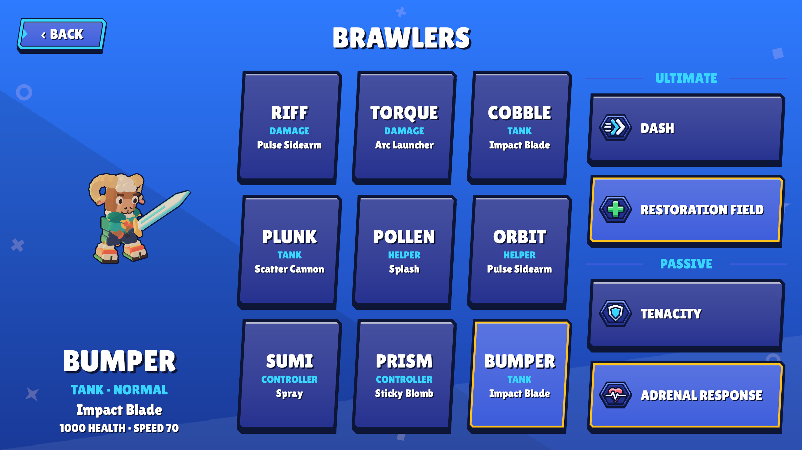
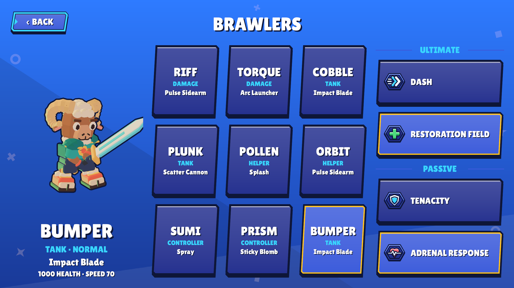

# Found (BRL-egn6 merge review, 2026-11-20)
At 1280x720 the Brawlers screen portrait column (27% of the body row, `flow/screens/brawlers.rs` `portrait`) is narrow and tall. The preview camera is shared with the Dashboard (`dashboard.rs` `bind_dashboard_preview_host` moves the `ViewportNode` between hosts) and is framed for the Dashboard's wider host, so Bumper's blade is cut at the right edge. At 914x411 it fits.

# Plan
Frame the preview to the host's aspect (fit the character's bounds horizontally as well as vertically), or give the portrait host a wider minimum aspect. Keep the Dashboard framing unchanged.

# Acceptance
Shell captures `brawlers-picked` at 1280x720 and 914x411 show Bumper's whole blade; Dashboard captures unchanged.

# Implementation (2026-11-20)
`packages/brawler-client/src/dashboard.rs`: the shared preview camera keeps its vertical FOV (`PREVIEW_FOV` 0.42) on hosts at least `PREVIEW_FRAMED_ASPECT` (1.25) wide, and `frame_dashboard_preview_to_host` widens the vertical FOV on narrower hosts so the horizontal coverage matches the 1.25 framing. It reads the current host's `ComputedNode` each frame (the host moves between Dashboard and Brawlers) and marks the projection changed only on a real change. Measured host aspects: Brawlers portrait ~0.8 at 1280x720 (blade clipped) and ~1.2 at 914x411 (blade just fit); Dashboard hosts ~1.4 and wider, so they keep the old framing.

# Verification
- `cargo test -p brawler-client --lib dashboard`: 20 passed, including the new `preview_widens_its_field_of_view_only_on_hosts_narrower_than_the_framed_aspect`.
- `just lint`: passed.
- `scripts/shell-capture.sh brawlers-picked all` and `dashboard all`, before (`target/qfv2-before/`) and after (`target/qfv2-after/`): Bumper's whole blade is inside the preview at 1280x720 and 914x411; Dashboard framing at both sizes is unchanged (only the idle pose differs). Bumper reads smaller in the 1280x720 portrait column, the cost of fitting the blade.

# Playtest note
Owner: open Brawlers, pick Bumper, resize the window between narrow and wide; the blade should never clip. If Bumper reads too small in the tall portrait column, the alternative is widening the portrait column, not the camera.

