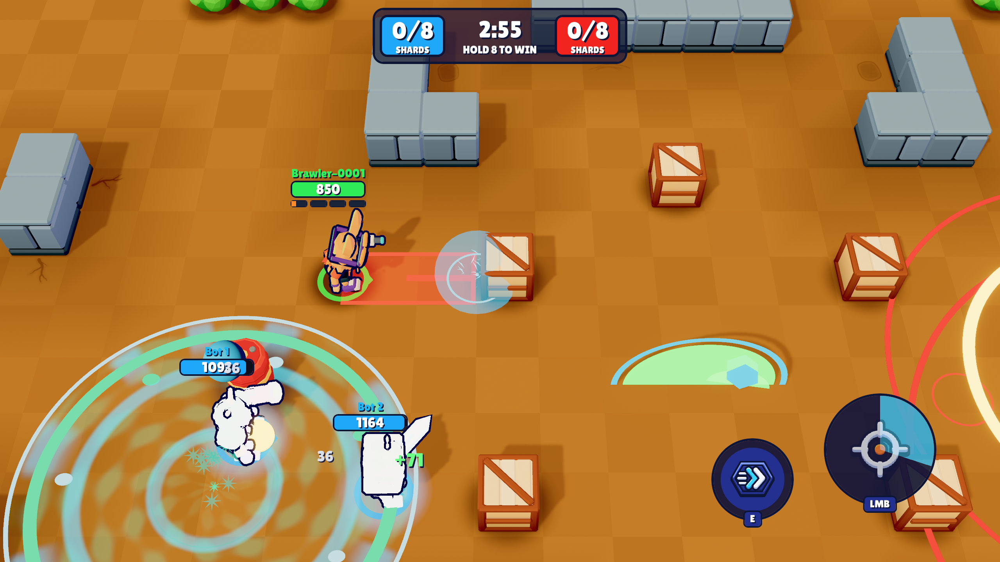
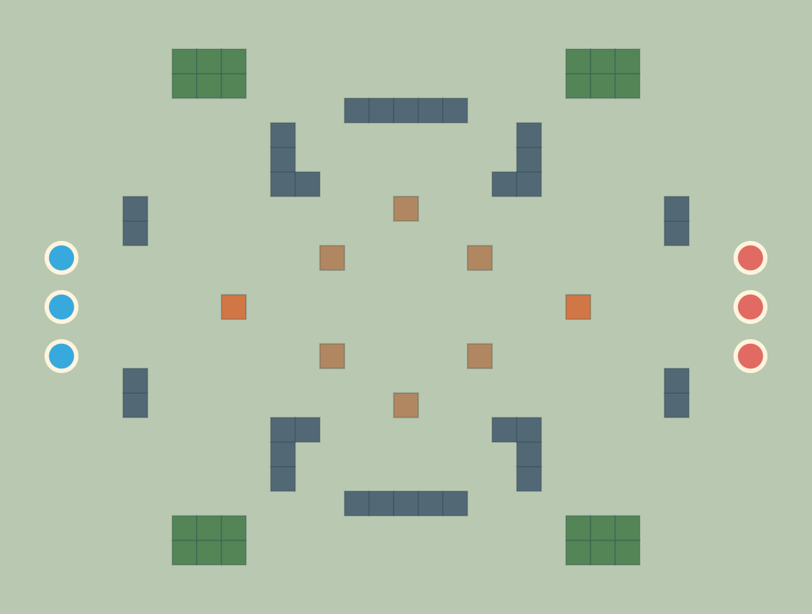

# Outcome

Players can queue or practice a complete team objective match that converts combat advantage into collecting, carrying, protecting, dropping, and recovering a contested resource, then holding a target count through a visible countdown.

# Naming

"Gem Grab" is the name of an existing commercial game's mode and must not ship as a player-facing name. The gameplay family (collect, carry, hold a threshold) is genre-generic and stays.

The working name is **Shard Rush**, with shards as the resource. This is pending the owner question on this ticket. Use the chosen name for the mode key, the `GameMode` variant, the game-type IDs, the HUD, and the docs. The internal identity (`GameMode::GemGrab`, `gem-*` keys) must not use "Gem Grab".

# Scope

- Add a focused mode plugin under `src/modes/` and `src/matchplay/` with stable rules, replicated public state, HUD, cues, results, restart, recovery, and routed admission compatibility.
- The new `GameMode` variant in `src/config.rs` is a closed protocol enum change and needs the global compatibility bump described in `docs/08-network-architecture.md`.
- Add typed map anchors for the resource source, plus one dedicated 3v3 map.
- Advertise a `<mode>-3v3` game type in `config/server/game-types.ron`. Other team sizes are out of scope unless the map and playtests show they work.
- The source spawns resources on deterministic bounded deadlines, up to an authored live-count ceiling.
- Live fighters collect resources through server-owned overlap, and the carried count is public and bounded.
- Defeat drops carried resources at validated positions. Disconnect, restart, and teardown each have an explicit outcome.
- When a team's combined carried count reaches the target, a visible hold countdown begins. Falling below the target applies the owner-chosen rule (see the questions).
- Timeout and simultaneous terminal conditions resolve deterministically.
- Practice bots get focused collect, protect-carrier, intercept-carrier, and recover-drop goals, acting only through ordinary input.

# Reuse: Zombie pickups

Zombie (`src/matchplay/zombie.rs`, `BoostPickup` and related types) already implements server-owned pickup entities, bounded carried counts, and drop-on-death as permanent pickups. Study it before writing new pickup code.

Extract a shared helper only for behaviour that is truly identical in ownership and lifecycle (AGENTS.md, `docs/04-maps-and-game-modes.md` "shared match machinery is extracted only where…"). Mode-specific scoring, spawning, and HUD stay mode-local. Record in this spec what was shared and what was not.

# Authored rule values

These are proposed defaults. They live in `game-types.ron` and mode policy, and all are converted with `src/timing.rs`:

- target team count: 8
- hold countdown: 12 s
- source spawn interval: 6 s, with a live-count ceiling of 12 on the ground
- maximum carried per fighter: the target count
- dropped resources scatter to validated free cells around the defeat position, never inside walls or out of bounds
- match duration, countdown, and respawn: the same as the other 3v3 modes

Tune these from playtest feedback.

# Concealment

Carrier visibility depends on the owner's answer to the concealment question. Whatever is chosen is enforced server-side through the existing concealment and interest path (`docs/17-concealment.md`), never only on the client.

# Build order (one ticket, reviewable steps)

1. Rules core: the mode variant, config, the source, collection, drops, threshold and countdown, results, and focused `App` tests.
2. Map: anchors, the dedicated 3v3 map, validation, and admission.
3. Presentation: HUD counts, the countdown, dropped-resource and source cues, and results.
4. Practice bots: collect, protect, intercept, and recover goals.
5. Routed and network tests, the performance gate, and the docs.

# Boundaries

- No generic inventory, currency, progression, loot rarity, random drops, executable map scripting, or additional mode framework.
- Resources exist only inside the active match and never enter player profiles.

# Acceptance criteria

- Collection, drop, pickup, threshold, countdown, cancellation or reset, timeout, draw, results, restart, late join, disconnect, and recovery rules pass focused tests and `tests/network/` scenarios.
- The dedicated map validates and gives fair approach, retreat, carrier-protection, and comeback paths.
- HUD and world feedback make source cadence, dropped resources, carrier counts, the threshold, and the countdown understandable in 3v3.
- The maximum 3v3 capacity and performance gate passes. Practice bots visibly pursue all four goals.
- `docs/04-maps-and-game-modes.md` moves the mode from "Envisioned mode families" to a supported mode section. The learning notes are recorded here.

# Verification

- `just lint` and `just test`
- `just practice-e2e <mode>-3v3`, `just rejoin-e2e <mode>-3v3`, and `just network-change-e2e <mode>-3v3`
- `just v3-render-evidence` with `BRAWLER_RENDER_GAME_TYPE=<mode>-3v3` and `BRAWLER_RENDER_PLAYERS_PER_TEAM=3`, with captures attached

# Playtest notes (owner, after done)

This is not a gate for done. The agent fills in the run path and controls when the work lands. The owner plays 3v3 Practice and observes:

- whether a leading team can be caught;
- whether carriers are worth protecting and hunting;
- whether the countdown reads clearly;
- whether retreating to stall feels degenerate.

# Decisions (agent, 2026-11-21)

Owner answers (approved on this ticket): name **Shard Rush** (resource: shards); concealment **no special rule** (carriers hide like anyone else; no concealment or interest change); countdown **resets** when the leader falls below the target.

Identity: `GameMode::ShardRush`, mode key `shard-rush`, `brawler_routing::GameMode::ShardRush = 5`, `SHARD_RUSH_MODE_DEFINITION = ModeDefinitionId(6)`, game type `shard-rush-3v3`. Adding the closed enum variants bumps `SUPPORTED_PROTOCOL_VERSION` 56 → 57 (one global handshake, per `docs/08`). No profile-DB, Balance Lab, or Map Maker draft format enumerates modes by variant for new rows, so no on-disk migration is needed (checked per the BRL-wg28 lesson; recorded under Verification).

Rules (authoritative, `src/matchplay/shard_rush.rs`):
- Authored values: `shards_to_win: 8` on the game-type row (the transported objective target); `mode_policies.shard_rush: (hold_seconds: 12, spawn_interval_seconds: 6, live_shard_ceiling: 12)` validated operator policy carried through the routing manifest like the Vault Break policy. Seconds convert through `src/timing.rs`. Code owns capacity ceilings (target ≤ 32, ground ceiling ≤ 24, ground entity hard cap).
- One `ShardRushSource` mode anchor (half-cell centre) per map. The first shard spawns at activation, then one per spawn interval while uncarried shards on the ground are below the ceiling. Spawn points fan out deterministically around the source and are resolved against blocking map geometry.
- A live, active, connected fighter whose position is within the pickup radius collects a shard (lowest shard ID first, then lowest network ID), up to `max carried = target`. The carried count is the replicated `ShardCarrier(u8)` fighter component (public, like `BoostStacks`).
- Defeat scatters all carried shards around the defeat position (golden-angle ring, resolved against blocking geometry and clamped inside playable bounds) as `Dropped` shards; a disconnected carrier drops at its last position the same way; restart despawns every shard and zeroes every carrier; completion despawns ground shards and freezes `ShardRushState` for Results; late joiners and rejoiners start at 0.
- Team totals are the sum of connected, active team members' carried counts. The hold countdown runs for the team whose total is ≥ target and strictly greater than the other team's; any tick where that stops holding (or the leader changes) clears it, and the next qualification restarts from the full duration (Reset). The countdown reaching zero is a Threshold victory. At the deadline a finished countdown still wins; otherwise the higher team total wins and equal totals draw. Only one team can own the countdown, so simultaneous threshold wins are impossible.
- Replicated root state `ShardRushState { match_id, source_anchor_id, team_shards, target, hold_ticks, countdown: Option<{team, ends_at_tick}>, ground_shards, next_spawn_at_tick }`; shard entities replicate `Shard`, `ShardIdentity`, `ShardOrigin {Source, Dropped}`, `Position`.

Reuse vs. Zombie: shared = the existing map helper `resolve_circle_against_blocking_map` for drop placement and the fighter-component replication pattern. Not shared = pickup entities, ID allocation, collection, and drop processing stay mode-local, because Zombie boosts are permanent stat stacks with team-scope grants and ambient drop budgets, while shards are a scored, droppable, capped team count — different ownership and lifecycle.

Bots: a new semantic `BotObjectiveView::CollectAndHold` plus a per-tick projection of ground shards (position, origin) and carriers (team, count, position). Goals: collect (nearest source shard), recover drop (nearest dropped shard, preferred when close), protect carrier (escort the ally carrying most), intercept carrier (chase the enemy carrying most), acting only through ordinary input.

Out of scope / deferred: Map Maker authoring for Shard Rush, other team sizes, bespoke audio stingers and shard VFX polish (linked backlog tickets).

# Implementation notes (agent, 2026-11-21)

Where the shipped code differs from the Decisions above, the code and this section win:

- Bot goals use semantic tactics `CollectShard`, `EscortCarrier`, `InterceptCarrier` (plus the existing contest-source move). Collection goes to the nearest visible shard, whether from the source or dropped, so "recover drop" is the same goal as collect rather than a separate preference. Priority: a threatened carrier retreats → intercept the nearest visible enemy carrier → collect the nearest shard → escort an allied carrier → contest the source. Bots fire whenever the aim target is in weapon range. Every Shard Rush member is an objective role.
- Carriers whose entity is removed (seat expiry, despawn on disconnect) are captured by an `On<Remove, ShardCarrier>` observer into `DepartedCarriers`; the drop transaction scatters them at their last position. Without it, a disconnected fighter's despawn destroyed its shards (found by the network test).
- Drops ignore the on-ground ceiling, so no shard leaves play. Ground ceiling applies only to source spawns.
- The deadline compares team shard totals (more wins, equal draws). A countdown that has not finished at the deadline does not win on its own.
- Routing: `AllocateRequest` and the match-role manifest gain the 5-byte `ShardRushPolicy`. Following the BRL-0061 precedent for a mode policy field, control IPC moves to v8 and the match manifest to v6 (lobby manifest unchanged). Operator catalog schema 6 → 7 (`mode_policies.shard_rush`). Protocol 57.
- Presentation: `presentation_3d/shard_rush.rs` has three reconcilers (ground shards, source pad, carrier crowns). Crowns follow replicated carrier entities, so concealment hides them with the fighter. HUD plate: "n/8 SHARDS" chips with "ALLY HOLD s" / "ENEMY HOLD s" / "HOLD 8 TO WIN". Results: "SHARDS HELD" current/target. Mode pennant `mode-shard-rush` (generated icon) and Prism Quarry overview art.
- Map: Prism Quarry, preset/recipe 15, mode definition 6, 33×25 facility theme, point-symmetric, `ShardRushSource` at the centre (placement 9500).
- No audio cues in this slice: audio producer registrations must cover the cue catalog exactly, so the cues go together in BRL-ge35.

# Deferred (linked backlog)

- BRL-ge35: Shard Rush audio cues and presentation polish.
- BRL-hapb: Map Maker authoring of Shard Rush recipes.
- BRL-xs4t: Shard Rush at other team sizes.

# Learnings

- Mistake: the first drop implementation relied on the roster diff to find disconnected carriers, but the disconnect path despawns the fighter in the same window, so the shards vanished. Cause: assumed fighter entities outlive roster removal. Prevention: for any per-fighter resource that must survive leaving, capture it with an `On<Remove, Component>` observer (the network test caught it).
- Mistake: a new mode policy field added to `AllocateRequest`/manifest without a version bump. Cause: docs/08's last entries said "control IPC v7 unchanged", which reads as a habit. Prevention: any body-shape change bumps control IPC (and the match manifest when it carries the field); check `git log -S` for the previous field's precedent.
- Adding `ResolvedMap` fields changes every resolved Debug digest in `src/map/compatibility_tests.rs` even though fingerprints and snapshots are unchanged; regenerate them and say so.
- New game types need: the e2e-practice allowlist, the `_practice-e2e-matrix`, the render-evidence mode list, the overview art generator list, the mode pennant in `build_icons.py`, and the dashboard/game-select badge arrays.

# Verification (agent, 2026-11-21)

All run in worktree `bold-fermi-964944`:

- `just lint`: pass (after splitting `plate_content`, the 3D reconciler, `drop_carried_shards` via `DropSignals`, the compatibility goldens, and the network harness mode setup to satisfy `too_many_lines` / `too_many_arguments` without allows).
- `just ci` (lint + all test suites + e2e matrix + Practice e2e matrix including `shard-rush-3v3`): pass, 24 suites, 2,659 tests.
  - Focused: 13 `shard_rush` unit tests (source cadence/ceiling/collect, countdown reset and win, defeated/disconnected/despawned drops, deadline draw/leader/hold); 3 bot tests (collect/recover/escort/intercept, threatened carrier retreat, Prism Quarry spawn reachability); admission, lobby catalog, config, registry, and compatibility tests.
  - Network (`tests/network/shard_rush.rs`, 3 tests): collection replicates; hold → reset → win → Results → restart clears shards; disconnected carrier drops.
  - Performance: `shard_rush_full_ground_with_six_fighters_stays_within_fixed_tick_budget` passes.
- `just practice-e2e shard-rush-3v3`: Practice reached Active with one human.
- `just rejoin-e2e shard-rush-3v3`: rejoined the same running match after an outage beyond the session bound.
- `just network-change-e2e shard-rush-3v3`: kept its match session across a source-port change and back.
- `BRAWLER_RENDER_MODE=shard-rush BRAWLER_RENDER_PRACTICE=1 BRAWLER_RENDER_COMBAT=1 just v3-render-evidence <abs path>`: pass, frame p50 8.8 ms / p95 10.6 ms / p99 11.8 ms, 0 frames over 50 ms; capture attached. (The script needs an absolute report path; a relative one fails when the client log is opened.)
- On-disk formats checked: the profile DB stores no mode; Balance Lab persists only Vault Break tuning; Map Maker drafts are untouched (no renames, additive enum variants). No migrations needed.
- Not done: native windowed playtest (owner, below).

# Playtest (owner)

- Run: `just server`, then `just client`. Dashboard → mode pennant **Shard Rush** → **Shard Rush 3v3** → Practice (Prism Quarry). Or `just practice-e2e shard-rush-3v3` for a headless smoke.
- Controls: the usual move/aim/attack/ultimate. Walk over a crystal to collect it.
- Observe: cyan crystals spawn at the centre pad every 6 s (max 12 on the ground); your carried count floats as a crystal crown; the plate shows team totals n/8. At ≥8 and strictly ahead, "ALLY HOLD 12…" counts down; losing a carrier or the lead resets it. Defeated carriers scatter their shards.
- Judge: can a leading team be caught; are carriers worth protecting and hunting; does the countdown read clearly; does retreating to stall feel degenerate (walled elbows and the long-edge blockers are the retreat spots).
- Known limits: no audio cues yet (BRL-ge35); 3v3 only (BRL-xs4t); not authorable in Map Maker (BRL-hapb).

# Evidence

# Review fixes (agent, 2026-11-21, after bed6317f)

Merge review findings, all confirmed and fixed on `claude/bold-fermi-964944`:

1. **Held seats kept their shards (medium, spec mismatch).** `participant_is_connected` counts a held routed seat as connected (BRL-yyeg), so a carrier whose link dropped got a `SeatHold`, kept its shards, still counted toward its team total (it could win the countdown while gone), and got them back on rejoin. Fixed in `src/matchplay/shard_rush/authority.rs`:
   - `drop_carried_shards` also scatters any carrier with `SeatHold` at its position.
   - `collect_shards` and `evaluate_shard_rush_hold` exclude `SeatHold` fighters, so the bot-driven held fighter neither collects nor scores, and a rejoining player starts at 0.
   - Tests: unit `a_held_seat_scatters_its_shards_and_neither_collects_nor_counts_while_held`; network `match_rejoin::a_held_shard_rush_seat_drops_its_shards_and_rejoins_with_none`. The network test uses the production routed match worker and the real session-loss → hold → rebind → reclaim path. `Harness::new_routed_match_with` now derives `ServerNetworkConfig.game_mode` from an edited manifest, as the production worker bootstrap does.
2. **Opening shard leaned toward team 1 (low, fairness).** Shard 0 used fan index 0, which is angle 0, 20 units east toward team 1's spawns. The opening shard now spawns on the source anchor itself (offset zero), so it is equidistant from mirrored spawns; later shards keep the golden-angle fan. The cadence unit test asserts it.
3. **Literal 60 Hz ticks (low, invariant).** `ShardRushPolicy::PROCESS_VERIFICATION` and the production fallback used 60/30 and 720/360 literals. Added a const `policy_ticks(seconds)` over `timing::simulation_ticks_from_seconds` and a `ShardRushPolicy::PRODUCTION` constant (12 s hold, 6 s cadence). Verification is 1 s and 0.5 s (`policy_ticks(1) / 2`). In-crate fixtures that needed the production values now reference `PRODUCTION`. `brawler-routing` codec fixtures keep literal bytes, because that crate cannot depend on `brawler` timing.

docs/04 now says that a held seat scatters, neither collects nor counts, and that the opening shard spawns on the source.

## Learning

- The roster's "connected" set includes bot-held routed seats by design. A mode rule about a *player's* presence must check `SeatHold` explicitly, not only `ConnectedMatchRoster`. The original disconnect test only covered entity removal and roster removal, not the held path; routed-seat behaviour needs a `match_rejoin`-style network test.

## Verification (review fixes)

- `just lint`: pass.
- `just test`: pass, 24 suites, 2,662 tests, 0 failed (the 3 added tests included).
- `just rejoin-e2e shard-rush-3v3`: the first run failed when the match worker crashed with an unrelated combat panic (`payload event reservation matches healing`, `transaction.rs:492`). A composed heal on a target defeated earlier in the same batch takes an event that was never reserved. No combat code differs from `main`. Filed as BRL-40b4. The next 3 consecutive runs passed: "rejoined the same running match after an outage beyond the session bound".
